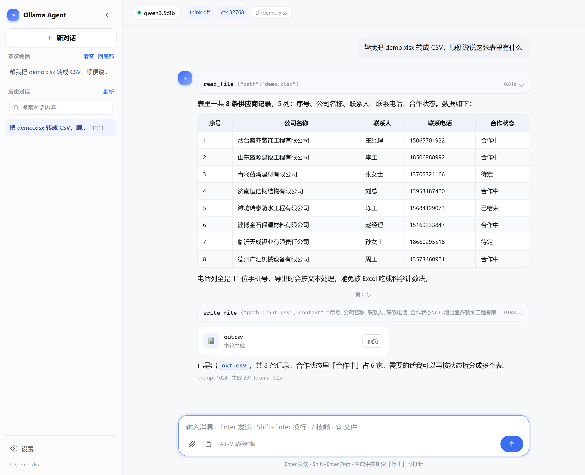
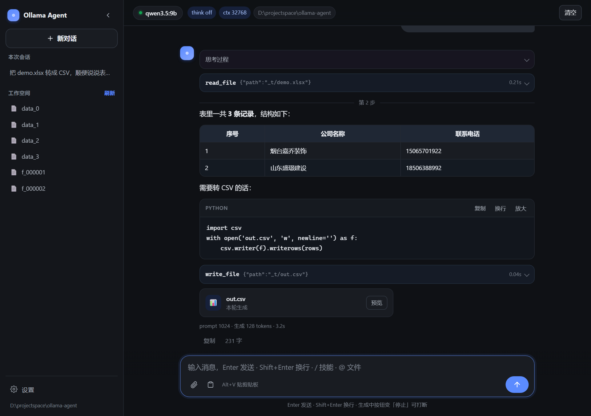

# Ollama Agent — 本地小模型工具调用代理

[English](README_EN.md) | **简体中文**

<p align="center">
  
  
</p>

**[EN]** A minimal agent for **small, local Ollama models**: function calling + thinking
off by default + file I/O (Office & PDF) + vision + web search, with a zero-framework
Web UI and confirmation gates on destructive tools. See [README_EN.md](README_EN.md).

一个为**本地 Ollama 小模型**（如 `qwen3.5:9b`）设计的极简 Agent：
工具调用（function calling）+ **默认关闭思考（think=false）** + 文件读写 + 图片理解 + PDF 阅读 + 联网搜索/读网页。

> 为什么自己做：市面上的 Agent 框架对本地小模型不友好——要么太慢、要么吃 context。
> 这个项目核心诉求就两条：**能选 think=false**（省时间省 token），**context 可控**（默认 65536）。

## 环境要求

| 依赖 | 说明 |
|---|---|
| Python 3.10+ | Ollama 通信走标准库 urllib |
| openpyxl / python-docx | Excel / Word 读写（`pip install -r requirements.txt`） |
| PyMuPDF | PDF 读取：抽文字层 + 按页渲染成图给视觉模型（同上，不装只影响 .pdf） |
| [Ollama](https://ollama.com) | 本地服务运行在 `http://localhost:11434` |
| 带 tools 能力的模型 | 如 `qwen3.5:9b`（capabilities 需含 `tools`） |
| Playwright（可选） | 仅 `browse_url` / `web_screenshot` / `web_search` 兜底需要 |

```bash
# 基础依赖（Office 读写）
pip install -r requirements.txt

# 可选依赖（要用联网/读网页才装）
pip install playwright
playwright install chromium

# 拉模型（示例）
ollama pull qwen3.5:9b
```

## 快速开始

```bash
# 图形界面（推荐）：浏览器聊天界面，流式输出 + 工具卡片 + 设置面板
python -m webui                # 打开 http://127.0.0.1:8888/
python ollama_agent.py --ui    # 等价

# 交互模式（think 默认关、自动预热模型）
python ollama_agent.py

# 单次执行
python ollama_agent.py -p "看看当前目录有什么，然后读一下 README.md"

# 指定工作空间（相对路径读写的根）
python ollama_agent.py -w D:/docs -p "读一下 周报.docx"

# 也可以用模块方式启动（等价）
python -m agent -p "..."
```

首次运行会预热模型（加载进内存/显存，你这卡可能要几十秒到几分钟），**之后同一会话内秒级响应**。

> **快捷启动**：根目录的 `ollama_agent.bat` 已默认带 `--ui`，且本目录已加入用户 `PATH`——任意目录下直接敲
> `ollama_agent` 就打开 Web UI（工作空间 = 你当前所在目录）。`ollama_agent -p "问题"` 走单次执行，
> `ollama_agent --help` 看全部参数，`ollama_agent --port 9000` 会自动补上 `--ui`。新加的 `PATH` 只对新开终端生效。
>
> 启动前会先探一下 `http://127.0.0.1:11434`：没响应就自动拉起 Ollama（优先桌面版 `ollama app.exe`，
> 没有则 `start /min ollama serve`），最多等 40 秒再进 UI。`--help` / `--version` 不碰服务端。
>
> 服务就绪后**会先预热模型**（把权重加载进显存/内存），终端打印 `模型就绪（72.7s）` 之后浏览器才打开，
> 第一句话不用再干等。冷启动在这台机器上约 73 秒；`--no-warm` 可跳过，Ctrl+C 也能跳过。
>
> **只用外部模型（中转站 / vLLM / LM Studio）就用 `ollama_agent_ui`**（根目录 `ollama_agent_ui.bat`）：
> 它**不探测也不拉起本地 Ollama**，并且**跳过模型预热**，实测约 3.4 秒出页面。第一次进去在
> 设置 → 模型管理 → 新建 里填 `/v1` 地址 + Key，保存后每次启动自动沿用，不用再带参数。
> 它只在没传 `--port` 时检查 8888 是否被占用并直接报错退出——因为 Windows 允许第二个进程绑定
> 已在监听的端口，不拦的话新进程看着"启动成功"，浏览器打开的却是旧窗口。

## Web UI（图形界面）

不想敲命令就用它——`python -m webui` 启动后自动打开浏览器：

```bash
python -m webui                      # 默认 127.0.0.1:8888，只监听本机
python -m webui --port 9000          # 换端口
python -m webui -w D:/docs           # 指定工作空间
python -m webui --no-hotkey          # 不注册全局热键
python -m webui --no-browser         # 不自动开浏览器（远程/二次刷新用）
python -m webui --no-warm            # 启动时不预热模型（默认会先加载进显存）
python ollama_agent.py --ui          # 同上（--port 同样可用）
```

**界面能力：**

| 能力 | 用法 |
|---|---|
| 流式对话 | 打字 → Enter 发送（Shift+Enter 换行）；回答逐字流出，工具调用显示为可展开卡片（参数 + 结果 + 耗时） |
| 左侧栏 | 「+ 新对话」、本次会话提问大纲（点击跳转）、**历史对话列表**（点击切换、悬停 × 删除、当前高亮）；窄屏自动变抽屉 + 遮罩 |
| 历史对话 | 每条对话独立存档（标题取第一句提问），关掉浏览器/重启服务后仍在；启动自动接上最近一条，点列表任意一条即回放当时的提问、回答、工具卡片与代码块 |
| 对话搜索 | 侧栏搜索框 `Ctrl/⌘+K` 聚焦，输入即搜（220ms 防抖）。搜的是**对话正文**——提问、回答、思考过程、工具参数与结果都能命中，结果行给出命中位置标签 + 上下文片段并高亮关键词；空格分隔多个词表示「同时包含」；Esc 清空 |
| 清空 / 删除 | 侧栏「本次会话」标题旁的「清空」只清当前这一条（弹确认并写明「另外 N 条不受影响」）；历史列表里每条悬停出 × 删除。两者都会连存档一起删掉，无法恢复 |
| 一键复制 | 每条回答下方「复制」（复制整段 Markdown），代码块右上「复制 / 换行 / 放大」 |
| 代码卡片 | 带语言标签与操作按钮，长代码可「放大」进大窗口再看，也可直接下载为文件 |
| 文件预览 | 工具生成/引用的文件显示为文件卡片，点「预览」直接看内容：文本/代码高亮底色、Markdown 渲染、**xlsx/csv 转表格**、图片内嵌；可一键下载 |
| 图片查看 | 任意图片（用户附图 / 工具截图 / Markdown 图片）点开放大，支持切换原始尺寸、下载，Esc 或点击关闭 |
| 表格渲染 | 模型输出的 Markdown 表格自动渲染成真表格（对齐、斑马纹、窄屏横向滚动） |
| 思考过程 | think 开启时收进「思考过程」折叠块，不打扰阅读 |
| 贴截图 | `Ctrl+V` 直接贴剪贴板截图（多张可连续贴） |
| 系统剪贴板 | 点附件按钮或页面内 `Alt+V`：截图 → 附件；Explorer 里 Ctrl+C 的文件 → 路径附件 |
| 全局 Alt+V | 热键在任何窗口都生效，剪贴板内容自动飞进对话附件栏（前端轮询取走） |
| 拖拽上传 | 文件拖进窗口：图片直接附上（视觉），其它文件存到 `{工作空间}/.ollama-agent/uploads/` 并附路径 |
| `/` 面板 | 输入框敲 `/` 弹命令面板：**指令**（reset/think）+ **技能**（技能库），↑↓ 选择、Enter 确认、Esc 关闭，支持继续输入过滤 |
| `@` 上下文 | 输入框敲 `@` 弹文件面板：模糊搜索工作空间文件，选中即附到下一条消息当上下文 |
| 工作空间文件 | 左侧栏「工作空间文件」分组：列出当前工作空间文件（最多 40 个），点击预览，`刷新`重扫；侧栏收起时一并隐藏 |
| 打断生成 | 生成中右下角按钮变红色「停止」，点了立即停（含工具循环、等确认的回合）；**关页面/刷新不再打断**——回合在后端继续跑，回来还能接上（见下「多会话并行」） |
| 输入队列 | 生成中输入后 Enter **不打断模型，自动排队**（输入框下方出现队列坞，宽度与输入框对齐）：每条可 ✈ 立即注入（走到步边界生效，回答不中断）、✎ 撤回继续编辑、🗑 删除；回合结束剩余消息自动依次续发；队列消息归属各自会话，切走再切回不会错发 |
| 多会话并行 | 每条对话是独立实例：**一条在生成时可以新建/切到另一条继续聊**，互不抢锁。会话列表实时徽标：● = 正在生成，✦ = 后台跑完待查看（2.5s 轮询），点开即清 |
| 刷新不断线 | 生成中刷新浏览器（甚至关掉再开）：后端照常跑完整个回合；前端启动先问 `/api/live`，抓到进行中的回合就增量接管画面，已流出的文字不丢 |
| 模型管理 | 「设置 → 模型管理」两块：**内置**（实时从 Ollama `/api/tags` 列出本机模型，点一下即切过去）+ **自定义**（填 `/v1` 地址 + Key + 模型名，接任意 OpenAI 兼容中转站；可新增/编辑/删除/切换）。「使用中」高亮全局唯一（内置/自定义互斥），切换请求行内转圈反馈 |
| 连通性测试 | 新建自定义模型时先点「测试连通性」：只看 `GET /v1/models`，不花对话费；地址错 / Key 错 / 服务没起 / 路径不对**分开报**，每条都给下一步动作 |
| 模型配置持久化 | 存在 `~/.ollama-agent/config.json`（`OLLAMA_AGENT_CONFIG` 可改路径）。重启后自动回到上次用的那个模型配置，不用重填地址和 Key |
| 偏好 | 「设置 → 偏好」：单回合最大工具步数、**执行前确认**、工作空间、think、num_ctx、temperature（后三项仅 Ollama 生效，OpenAI 协议下会置灰并说明原因） |
| 执行确认 | 写/改/删/联网/命令执行工具（`confirm=True`）执行前弹确认框：**允许 / 本回合全部允许 / 拒绝**；默认开启，5 分钟未确认自动拒绝（fail-safe） |

**预览接口：** `GET /api/file?path=…`（JSON 预览数据）、`?raw=1`（下载）。只允许工作空间内的路径，
跨目录访问返回 403；文本上限 400KB，表格取前 200 行 × 30 列。

**会话接口：** `GET /api/sessions`（列表 + 当前会话）、`POST /api/sessions/new|open|delete`、
`GET /api/sessions/search?q=关键词`（全文搜索，返回 `field` 命中位置 + `snippet` 片段；多词 AND、大小写不敏感；空查询返回空列表而不是全量）。
生成中**切换/新建照常放行**（并行会话，各自独立实例）；只有**删除**仍返回 409（防误删正在生成的对话）。

**并行会话接口：** `GET /api/statuses`（每条会话 `{busy, attention}`，前端 2.5s 轮询画 ●/✦ 徽标）、
`GET /api/live`（当前会话进行中回合的事件快照，刷新后增量接管画面用）、
`POST /api/steer`（往**正在生成**的回合注入一条用户消息，走到下一个步边界生效、不打断模型；回合空闲时返回 `{"error":"idle"}`，前端退化为普通发送）。

**会话存在哪：** 一条对话一个 JSON，默认 `~/.ollama-agent/sessions/<id>.json`（`OLLAMA_AGENT_SESSIONS`
可改目录，测试靠它隔离）。文件里同时存两份东西：`history` 是喂给模型的完整上下文，`turns` 是
界面回放用的流式事件（文字 / 思考 / 工具调用 / 工具结果 / 用量），所以切回旧对话能原样还原
工具卡片和代码块，不是只剩纯文本。工作空间文件列表在左侧栏底部（点击可预览，`刷新`重扫）；
没有任何提问的空会话不列进历史；工作空间换了会新开一条对话，旧对话照样留在列表里。

**模型配置接口：** `GET /api/models`（内置模型清单 + 自定义配置列表，Key 一律打码）、
`POST /api/models/probe`（测连通性，返回 `stage` = `url|auth|connect|http|parse` + `hint`）、
`POST /api/models/save`（新增或修改，返回落盘的 `id`）、`POST /api/models/activate`（切换，含切回内置）、
`POST /api/models/delete`（内置条目不可删，删生效项会自动回落到本地 Ollama）。

**模型配置存在哪：** `~/.ollama-agent/config.json`（`OLLAMA_AGENT_CONFIG` 可改路径），和会话存档同目录
但职责不同 —— 会话存档记「聊了什么」，这里记「连哪个模型怎么连」。文件分两段：`profiles` 是自定义模型
（地址/Key/模型名/推理参数），`ui` 是使用习惯（确认开关、步数、工作空间）；切模型不会把你的确认设置一起重置。
内置 Ollama **不写进文件**（模型列表每次都从 `/api/tags` 实时读，写进去就会过期）。
API Key 明文存在该文件、仅靠文件权限保护（POSIX 下 0600），接口回传一律打码，前端拿不到完整 Key；
编辑时 Key 框留空表示「不修改」。

**注意：** 改工作空间会新开一条对话（旧对话仍在历史列表）；改 num_ctx 会触发模型重载。
UI 只绑定 `127.0.0.1`，不开对外端口。**执行前确认默认开启**——写/改/删文件、跑命令、联网类工具（`confirm=True`）会先弹窗要人点头，防止模型自作主张；本地可信场景可在设置面板关掉。

## 命令行参数

```
--host        Ollama 地址，默认 http://localhost:11434
--model       模型名，默认 qwen3.5:9b
--think       off|on|low|medium|high|max|auto   默认 off（= think:false）
              auto = 不传 think 字段（兼容不支持思考的模型）
--ctx         num_ctx，默认 65536；0 = 用 Ollama 服务端默认
              上限 1048576，超出会被钳到该值（填更大只会 OOM，不是"更聪明"）
              ⚠️ 改 ctx 会触发模型重载，一个会话内别随便改
--temp        temperature，默认 0.7
--img <路径>  给第一条消息附图片，可多次
-p, --prompt  单次执行（非交互），跑完即退
-w, --workspace  工作空间目录：相对路径读写的根，默认当前目录
--max-steps   单回合最大工具步数，默认 12
--no-tools    禁用全部工具，纯聊天
--confirm     写/改/删文件、跑命令、联网前需要人工确认（y/N）
--no-color    关闭彩色输出
--hide-think  开思考时也不打印思考过程
--no-warm     跳过交互模式的模型预热
--no-palette  关闭 / 与 @ 的行内选择面板（回退为普通输入）
--no-hotkey   不注册全局热键 Alt+V（剪贴板进对话）
--ui          直接启动 Web UI（等价 python -m webui）
--port        Web UI 端口，默认 8888
```

### think 模式说明

| 值 | 行为 |
|---|---|
| `off`（默认） | 传 `think=false`，不思考直接答，**最快** |
| `on` | 传 `think=true`，完整思考 |
| `low` / `medium` / `high` / `max` | 传对应思考深度（需模型支持） |
| `auto` | 不传 think 字段，由模型自己决定 |

## 交互模式命令

启动后直接打字对话，模型会自动调工具。

### `/` 调用技能与指令 · `@` 添加上下文（行内面板）

敲 `/` 或 `@` 就在输入行下方弹出候选清单，**↑↓ 移动、Enter 确认、Esc 关闭**，
继续打字即按前缀过滤（文件与前缀严格过滤；指令按前缀过滤；技能只排序不淘汰，与 WebUI 面板同语义）：

```
你> /
  指令
▸ /img  — 附图片 <路径>
  /paste  — 剪贴板进对话
  /think  — 思考模式 <off|on|low|medium|high|max|auto>
  /model  — 切换模型 <名>
  /ctx  — 设置 num_ctx <整数>
  /ws  — 查看/切换工作空间 [目录]
  /reset  — 清空对话历史
  /tools  — 列出已注册工具
  /skill  — 加载技能 <名称> [问题]
  /save  — 保存对话 <文件>
  … 还有 10 项（继续输入可过滤，↑↓ 可滚动）
  ↑↓ 选择 · Enter 确认 · Esc 关闭

你> /ui
  技能
▸ ui-design-system  — 专业UI生成与现有界面优化技能。当用户请求生成UI界面、设计页…
  其它技能
  brand-identity-design  — 从品牌策略到生产级交付资产的完整标识设计，含概念生…
  ↑↓ 选择 · Enter 确认 · Esc 关闭

你> /skill
  指令
▸ /skill  — 加载技能 <名称> [问题]
  技能
  skill-icon-generator  — 为技能、专家或项目生成简洁的 512×512 图标：方形 PNG…
  其它技能
  …（其余技能照常列出，↑↓ 可滚动）
  ↑↓ 选择 · Enter 确认 · Esc 关闭

你> 总结 @rep
▸ report.md
  report2.md
  ↑↓ 选择 · Enter 确认 · Esc 关闭

你>            ← @ 选中后：常驻这一行，随时知道带了什么
  ✓ 已附加：report.md（待发 1 个 · 再 @ 选中可取消）
```

> 一屏最多显示 10 条（以当前选中项居中滚动），分组标题与底部提示不占名额；
> 超宽行按显示宽度截断（中文算 2 列），防止折行把重绘搞错位。

- `/` → 指令 + 技能库；选中指令回填 `/reset `，选中技能回填 `/skill <原始名> `，接着写问题即可一次发。
- `/skill ` → **二级补全**：打完 `/skill` 空格后继续列技能候选（继续打字按名过滤），选中回填 `/skill <名> `；
  名字写完再打空格即收起面板，接着写问题。
- 技能**不会被过滤淘汰**：「技能」组是命中的（排前面），其余归「其它技能」组照常列出，方便按名字浏览挑选。
- `@` → 工作空间文件（**前缀匹配**：`@rep` 只剩 report 系）；选中后 `@token` 自动从输入行摘除，
  文件挂到下一条消息（图片进视觉，其它附路径让模型读）。
- **回车的语义**：面板开着就选中当前项（第一个候选也能直接选上）；已打全名（`/reset`、`@readme.md`）回车 = 立刻执行/发送；
  光打 `/` 回车 = 列指令清单（浏览）。Esc 关掉面板后回车按原文发送。
- **已附加反馈**：选中后输入行下方常驻一行 `✓ 已附加 2 个：[1] a.docx  [2] b.xlsx`，带编号、实时更新；
  **输入行为空时按退格 = 逐个移除附件**（像删字符一样往回删，不用再敲 @ 找文件）；删中间某个时再敲 `@`，
  已附文件带 `✓` 排在列表末尾，回车即取消。
- **不会误发**：有待发附件时直接回车只提示「接着写你的问题」，不再替你发一条空消息。

斜杠命令全表：

```
/                 列出指令 + 技能库一览
/img <路径>       给下一条消息附图片（可连续多次）
/paste            把剪贴板内容附到下一条消息（截图→图；Ctrl+C 文件→路径）；Alt+V 同效果
/think <模式>     运行中切换思考模式
/model <模型名>   切换模型
/ctx <整数>       设置 num_ctx（0 = 服务端默认；改值触发重载）
/ws [目录]        查看 / 切换工作空间
/reset            清空对话历史
/tools            列出已注册工具
/skill <名称> [问题]  加载技能进对话；带问题则注入后直接让模型答题
/<技能名> [问题]  快捷调用技能（如 /ui-design-system 设计一个设置页）
/save <文件>      保存对话历史为 JSON
/load <文件>      读入对话历史
/help             帮助
/exit             退出
```

### 打断正在生成的回答（Ctrl+C）

生成过程中按一次 `Ctrl+C` = **只停本轮，不退程序**：断开流式连接（Ollama 随即停止生成）、
已生成的部分留在对话历史里（标记「已被用户打断」），回到 `你>` 提示符可以直接接着问，
上下文不丢。

| 按 Ctrl+C 的时机 | 效果 |
|---|---|
| 模型正在输出文字 | 停输出，部分回答入历史，回提示符 |
| 工具执行到一半（如长命令） | 停工具，未执行的 tool_calls 补「已被用户打断，未执行」占位，历史保持合法 |
| 等待工具确认弹窗（`? 允许执行…`） | 取消本次运算，回提示符 |
| 提示符处（没在生成） | 退出程序（等同 `/exit`） |
| `-p` 单次模式 | 中断并返回退出码 130 |

与 WebUI 的「■ 停止」走同一套取消逻辑（`run_turn(cancel=)` / `client.chat(cancel=)`），
行为一致；WebUI 里关页面或点停止也会同样干净收尾。

### @ 添加上下文（CLI 与 WebUI 同语义）

敲 `@` 会先弹候选面板（见上），选中的文件挂到下一条消息；也可以直接在消息里手写 `@名称`，
发送时做模糊匹配并把工作空间文件附进对话：

```
你> 总结 @report 的要点        ← report.md 唯一命中：自动附上（正文里的 @report 换成相对路径）
你> 对比 @report               ← 多个命中（report.md / report2.md）：列出来选编号
你> 看 @截图.png 讲了什么       ← 图片直接进视觉
你> @报告.docx                 ← 整条消息只有 @引用：附上后按"看一下我附带的内容"发出
你> @                          ← 单独一个 @ 回车：选中第一个文件（面板里看得见清单，↑↓ 挑）
```

细节：`@报告的要点` 这类中文紧邻写法会自动裁掉尾部中文再匹配（→ `报告.md`）；`foo@bar.com` 这类邮箱不会误伤；同一文件 @ 多次只附一次；`.git`/`.workbuddy` 等目录跳过；没命中原样保留并提示。单次模式 `-p` 同样支持。

面板需要 Windows 控制台且支持 ANSI 光标控制（Windows Terminal / Win10+ conhost 均可）；
控制台不支持时启动会提示并自动回退普通输入，也可显式 `--no-palette` 关闭；
管道/重定向（非 TTY）环境自动走普通 `input()`，不影响脚本调用。

### 使用示例

```
你> 截图后 /paste
已附加剪贴板截图 → 缓存 .ollama-agent\clip\clip_20261101_122307.png（待发 1 张）
你> 这张图写了什么？
你> 把上面的内容整理成 notes.md
你> 读一下 周报.docx 和 销量.xlsx，各总结一句
你> 我刚截图了，看看剪贴板里那张图是什么        ← 不用 /paste，模型自己调工具
你> 用 web_search 搜一下 Ollama think 参数怎么用，总结给我
```

## 工作空间

所有文件类工具（读/写/列目录/图片）遵守同一套路径规则：

| 你写的路径 | 实际位置 |
|---|---|
| `notes/hello.md`、`周报.docx`（相对路径） | `{工作空间}/notes/hello.md` |
| 不传 path（list_dir） | 工作空间根目录 |
| `D:/docs/a.txt`、`~/x.png`（绝对路径 / `~`） | 按原样，可超出工作空间 |

- 默认工作空间 = 启动时的当前目录；`-w DIR` / `--workspace DIR` 指定
- 交互中 `/ws` 查看、`/ws 新目录` 切换（会重置对话历史，让模型知道新根）
- 系统提示词会告诉模型当前工作空间在哪，所以直接说"读一下 周报.docx"它就能找对

## 内置工具（19 个，其中 `web_chat` 为私有可选模块）

> 公开仓库是 **18 个**（`web_chat` 因 ToS 原因不入库，见 `.gitignore`）。复现：
> `python -c "import sys;sys.path.insert(0,'.');import tools;from agent.registry import all_specs;print(len(all_specs()))"`

| 工具 | 功能 | 备注 |
|---|---|---|
| `read_file` | 读本地文件：**文本 / Word / Excel / PPT / PDF** | 见下方格式支持；太长会劝你换 `read_long_doc` |
| `read_long_doc` | **长文分段精读**：几百页/几十万字的文档一次读不完时用它 | 见下方「长文怎么读」 |
| `write_file` | 写本地文件：**文本 / Word / Excel**（按扩展名生成真格式） | 见下方格式支持；`--confirm` 可把关 |
| `edit_file` | **精确替换文件片段**（old_string→new_string，外科手术式） | 默认要求唯一；`--confirm` 可把关 |
| `delete_file` | 删除文件/目录（破坏性，不可恢复） | 工作空间外拒绝 |
| `list_dir` | 列目录（大小、子目录） | 默认列工作空间 |
| `run_command` | **执行 shell 命令**：测试/git/装依赖/lint/编译 | git 直接用命令即可；`--confirm` 可把关 |
| `grep_file` | **搜文件内容**（正则，`文件:行号: 命中行`） | 跳过 .git/node_modules 等噪声目录 |
| `glob_file` | **按文件名模式找文件**（`*.py`、`src/**/*.ts`） | 不含 / 的模式任意子目录递归匹配 |
| `load_image` | 加载图片 → base64 喂给视觉模型；**PDF 可按页渲染成图片** | 文档类会被拒并引导 read_file |
| `render_sheet` | **表格渲染成图片**（xlsx/xlsm/csv/tsv → PNG 截图） | 「看看表格做得对不对/长什么样」用它，比 read_file 更直观 |
| `clipboard_image` | **读剪贴板**：截图→图；Ctrl+C 文件→路径 | Alt+V / /paste 同源，见下 |
| `browse_url` | Playwright 打开网页提取正文 | 读文章/文档/链接 |
| `web_screenshot` | **网页/HTML 截成图片**（首屏或整页长图 → base64 喂视觉模型） | 「截个图看看这页面渲染对不对/版式有没有错」用它；只看文字用 browse_url |
| `web_search` | 联网搜索：**双引擎并行**（Bing 结果 + 百度AI摘要/结果） | 摘要够用可免 browse |
| `web_chat` | **免费网页版 AI 外脑**（文心一言 / 豆包）问答 | 私有可选模块（不入库），需先 `--login` 登录一次 |
| `skill` | **按需加载技能指令**（SKILL.md 工作流文档） | 见下方技能说明 |
| `verify` | **按编码规范跑机械判据**：语法编译 / 文档断链 / 文档代码块 compile / 跑测试 | 配套内置技能 `coding-standards`，见下 |
| `todo_write` | **任务清单外置**：pending / in_progress / completed 三态，整表替换、同时只许一个 in_progress | 跨轮次持久（存 `{工作空间}/.ollama-agent/todo.json`），多步任务先写清单再干活 |

### 写代码闭环（run_command / grep_file / glob_file / edit_file）

四个工具补齐后，「搜到 → 读 → 改 → 跑测试 → 看报错 → 再改」的最小闭环成型：

```python
grep_file(pattern="def run_turn")            # 内容定位：谁定义/谁调用
glob_file(pattern="tests/**/*.py")           # 文件名定位：有哪些测试
read_file(path="agent/loop.py", offset=1)    # 读懂上下文
edit_file(path="agent/loop.py",              # 精确替换，不整文件重写
          old_string="旧代码（与原文完全一致且唯一）", new_string="新代码")
run_command(command="python tests/test_tools.py")   # 跑测试验证
```

要点：

- **edit_file**：`old_string` 必须与文件内容完全一致（可直接抄 `read_file` 输出，换行已自动归一化），
  且默认**只允许出现 1 次**——不唯一会拒绝，扩上下文或传 `replace_all=true`。新建文件/整文件重写仍用 `write_file`
- **run_command**：工作目录默认工作空间（`cwd` 可改）；默认 120s 超时（`timeout` 可调，上限 600）；
  stdin 不可用，交互式命令会卡到超时；Windows=cmd / Linux·Mac=sh 语法
- **grep_file / glob_file**：跳过 `.git`/`node_modules`/`__pycache__` 等噪声目录和二进制文件；
  `glob`/`pattern` 不含 `/` 时任意子目录递归匹配（`*.py` = 全工程 py 文件）
- **安全**：`edit_file`/`run_command` 均 `confirm=True`，CLI `--confirm` / Web 确认弹窗人工把关；
  破坏性命令（删数据、`git push --force`）系统提示词要求只在用户明确要求时执行

### 编码规范：`coding-standards` 技能 + `verify` 工具

仓库自带一份**写代码的标准**，随仓库走，任何工作空间启动都能用：

| 层 | 载体 | 管什么 |
|---|---|---|
| 判断标准 | 技能 `coding-standards`（`skills/coding-standards/SKILL.md`） | 四条铁律、验证六档、错误文案要指路、禁止清单、交付检查表 —— 讲清"什么算写完了" |
| 机械判据 | 工具 `verify` | 能不能机械判定的事，真跑一遍，不信自述 |

```python
verify(checks=["syntax"])                    # 第 0 档：内存 compile，报 文件:行号（不落 __pycache__）
verify(checks=["links", "blocks"], path="docs")   # 文档断链 + 文档里 Python 代码块能否 compile
verify(checks=["tests"])                     # 真起进程跑 tests/test_*.py，报退出码 + 末行
```

设计要点：

- **两半分权**：错误文案该不该指路、图会不会重叠、估算有没有标注，机械判不了 → 交给技能讲；
  "能不能编译""链接断没断"骗不了人 → 交给工具跑
- **verify 通过 ≠ 交付合格**：工具结论里会明说这一点，避免"绿灯就当完事"
- **内置技能优先级最低**：`{workspace}/.workbuddy/skills` > `~/.workbuddy/skills` > 仓库 `skills/`，
  放一份同名技能到用户目录即可覆盖，不会被仓库锁死
- **docstring 与实际一致**：`verify` 只做只读检查，不需要确认；跑测试走 `run_command` 的确认闸

人类阅读版：[`docs/CODING_STANDARDS.md`](docs/CODING_STANDARDS.md)。两版同源，
`tests/test_coding_standards.py` 会校验关键条款没有单边丢失。

### delete_file 说明（破坏性，不可恢复）

```python
delete_file(path="tmp.log")                  # 删文件 / 空目录
delete_file(path="build", recursive=True)    # 删非空目录（必须显式 recursive=true）
```

安全设计（删错无法找回，所以门槛比 write_file 高）：

1. **工作空间外一律拒绝**（read/write 允许绝对路径出工作空间，delete 不允许）；工作空间根目录也拒绝
2. **非空目录必须 `recursive=true`**：不传时拒绝并列出顶层内容（数量/大小/名称），方便先跟用户核对
3. **人工把关**：CLI 加 `--confirm` 后删除前弹 y/N 确认（和 write_file/联网同机制）；Web UI 默认弹网页确认框

### 技能（skill）

技能 = 一份 Markdown 工作流指令（SKILL.md，与 WorkBuddy 技能同格式）。机制：

- **索引常驻**：启动/新会话时把「技能名 + 一句话描述」注入系统提示词（几十 token）；
- **正文按需**：任务命中某技能主题时模型调 `skill(name="…")` 加载全文，避免撑爆 32K 上下文；
- **扫描目录**（同名先者胜）：`{工作空间}/.workbuddy/skills/`（工作空间级）→ `~/.workbuddy/skills/`（用户级）→ `~/.workbuddy/user-*-personal/skills/`（账号级）；
- 加载时附**工具名映射提示**（Read→read_file、Edit→edit_file、Bash/Shell→run_command、Grep→grep_file、Glob→glob_file 等，防模型照抄技能里的 WorkBuddy 工具名；Task/子代理没有，改为连续调用工具）；
- 超长正文默认截 20000 字符（`max_chars` 可调），截断时提示用 `read_file` 续读。

```python
skill()                          # 列出全部技能
skill(name="ui-design-system")   # 加载该技能指令全文
```

对话里也可直接发命令：CLI 用 `/skill <名称> [问题]` 或快捷的 `/<技能名> [问题]`；WebUI 敲 `/` 从面板选（或手输 `/skill <名称> [问题]`）。带问题都会先注入技能再让模型答题。

注意：技能是给模型看的指令文档，动辄上万 token——大技能（如 dev-expert 65KB）对小模型负担重，摘用为宜。

### 剪贴板截图 / 文件（Alt+V、/paste、clipboard_image）

截图（Win+Shift+S、QQ/微信截图等）通常只进剪贴板、没有文件；Explorer 里 Ctrl+C 的文件也在剪贴板——**Alt+V 全局热键**一键带进对话：

| 剪贴板里是 | Alt+V 之后 | 效果 |
|---|---|---|
| 截图 / 图片位图 | 图挂到下一条消息（缓存到 `.clip_cache/`） | 模型直接"看"到 |
| Ctrl+C 的文件（可多选） | 文件路径注入下一条消息 | 模型自己 `read_file` / `load_image` 读 |
| 都没有 | 提示"剪贴板里没有图片或文件" | 不装死 |

- **Alt+V**：全局热键（任何时候按，不需要先点终端），等价于敲 `/paste`
- 也可以直接说"看剪贴板里那张图 / 那个文件"，模型自己调 `clipboard_image` 工具
- `save_as="shots/a.png"` 可把截图顺手另存；缓存目录 `.clip_cache/` 可随时整个删掉
- `--no-hotkey` 关闭热键；热键被其它程序占用时启动会提示、`/paste` 仍可用

> 实现：ctypes 直调 Win32（RegisterHotKey 热键 + CF_DIB/CF_PNG/CF_HDROP 剪贴板）+ 标准库 zlib 写 PNG。
> 仅支持 Windows；`.clip_cache` 里是标准 PNG，任何看图软件都能打开。

### read_file / write_file 格式支持

| 格式 | 扩展名 | read_file 输出 | write_file 输入 |
|---|---|---|---|
| 文本 | `.txt` `.md` `.csv` `.json` 代码/配置等 | 按行号分页（`offset`/`limit` 翻页） | 原样写文本 |
| Word | `.docx` | 按段落抽文本 | Markdown 子集（`#` 标题、`-`/`1.` 列表、`\| 表格 \|`、`**加粗**`、`` `代码` ``）→ 真 docx |
| Excel | `.xlsx` `.xlsm` | 按工作表输出单元格（表名 + 行列，共享字符串已还原） | **JSON 二维数组（推荐）** `[["列1","列2"],["值1","值2"]]` / CSV / TSV / Markdown 表格 → 真 xlsx；每行列数必须与表头一致，参差行报错回传（不静默错位）；`=== 表名 ===` 分节写多工作表 |
| PPT | `.pptx` | 按页抽文字 | ❌ 暂不支持生成（工具会提示） |
| PDF | `.pdf` | **按页返回文字**（`pages="1-5"` 指定页码；默认前 20 页、4 万字封顶） | ❌ 不生成（避免伪文件；用 Word/WPS 导出） |
| 旧版 | `.doc` `.xls` `.ppt` | ❌ 请另存为新格式（工具会提示） | ❌ 拒绝写入（避免产出伪文件） |

> 生成用 openpyxl（Excel）/ python-docx（Word）；解析同源库 + pptx 走 zip 抽字。Office/WPS 可直接打开产出的 docx/xlsx。
> Excel 数字自动识别为数值单元格；带前导零（如 `007`、区号）的长数字保持文本，电话/编号不会被 Excel 吃成科学计数。

### PDF 怎么读（两条路）

PDF 分两种，工具会自动判断该走哪条：

| PDF 类型 | 走法 | 表现 |
|---|---|---|
| 有文字层（Word 导出、网页打印） | `read_file` | 按页返回文字，省 token、能搜关键词；大文件用 `pages="1-5"` 分段 |
| 扫描件 / 纯图页（拍照、扫描、盖章） | `load_image(path=…, page=N)` | 把该页渲染成 PNG（默认 120dpi）交给视觉模型「看」 |

抽不到字时返回值里会直接写明「本次显示的页全部抽不到文字，基本可断定是扫描件」并给出下一步该调什么，
所以模型不会卡在「我读不了 PDF」上。加密 PDF 会明确回「需要密码（暂不支持）」。
`.pdf` 依赖 PyMuPDF（许可证 **AGPL-3.0**，自用无碍，对外分发前请确认）。

### 长文怎么读（分段精读）

文档几十万字、几百页时，`read_file` 一次塞不进上下文，而让小模型自己 `offset` 翻页会翻车：
`MAX_TOOL_STEPS` 只有十几步，翻七八次就耗光预算，然后凭开头几页的印象编答案。
所以长文交给 `read_long_doc`，**调度权在代码手里，模型只负责「读一段、记一段笔记」**：

```python
read_long_doc(path="docs/白皮书.pdf", question="我们的场景适合哪个方案？")
read_long_doc(path="docs/招标文件.docx", question="…", chunk_chars=20000)  # 手动指定单段字数
```

内部是一条固定的流水线：

| 步骤 | 谁做 | 做什么 |
|---|---|---|
| 1. 切段 | 代码 | 按**句子边界**贪心打包到预算内（`。！？；` 等），拼接无损、单句超预算才硬切 |
| 2. 需求分析 | 模型（1 次） | 从问题里提炼 3–6 条「该盯什么」的关注点；问题太笼统就退化为看全文结构与核心结论 |
| 3. 逐段精读 | 模型（每段 1 次） | 只带**关注点 + 前序笔记 + 这一段原文**，产出与本段相关的笔记；无关就回 `[无关]` |
| 4. 笔记收敛 | 代码判定 | 累计笔记超过上限就压缩到 65%，避免笔记自己撑爆上下文 |
| 5. 按笔记作答 | 主模型 | 只依笔记回答，覆盖不到就说「文档中没有提到」 |

预算都是按 `num_ctx` 实时算的（中文按最坏情况 1 字 ≈ 1 token）：先留 3500 给模板与生成余量，
笔记上限取 `ctx×18%`（夹在 1500–10000），剩下的全给原文。实测 `ctx=65536` 单段可读 5.2 万字。

笔记带**出处标注**，方便回查原文：文本给「行A–B」，PDF/PPT 给「第N页」。
几条防幻觉的硬约束也写进了最终提示：笔记没覆盖的必须说「文档中没有提到」、引用要带出处、
笔记互相矛盾要指出来而不是替文档圆场。

什么时候**不该**用它：
- **装得下就直读**：`ctx` 够大、全文一段装得完时，直接返回全文，**0 次子请求**（不白烧 token）；
- **Excel 不走它**：表格要按工作表读（`read_file` + `render_sheet`），切碎了反而丢行列关系；
- **扫描件不走它**：抽不出字的是图片，走 `load_image` 按页渲染。

多重入口保证模型不会走错路：① `read_file` 读到超长会直接返回「超出单次可读量」并点名换工具；
② 附件消息里预先点名超长文件；③ 两个工具的 description 互相交叉引用。

### 笔记会累积成一本（主题笔记库）

精读不是一次性的事。同一份文档会被反复追问，所以笔记**不按问题存，按文件存**——
一份文档对应一本可生长的笔记，内部按**主题**分节：

```markdown
## 目录
- 商户经营 …… 第3–4页
- 违约与赔偿 …… 第12页、第15页

## 主题笔记
### 商户经营
- 2024 GMV 1.2 亿，同比 +18%【第3页】
- 毛利率 22%，低于行业均值【第4页】

### 违约与赔偿
- 逾期付款日万分之五【第12页】
- 赔偿上限不超过合同总额 30%【第15页】

## 已答问题
- 商户经营情况如何？ → 商户经营
- 赔偿上限是多少？ → 违约与赔偿
```

每次追问变成「先查笔记 → 命中就只取相关那一节 → 没命中才精读并并入主题」。
**关键在只取相关的一节**：所以笔记总量可以无限增长，塞进上下文的永远只是那一小块。
这是它能撑住长文的原因，也是它和「整本笔记全塞进去」的根本区别。

| 层 | 作用 | 代价 |
|---|---|---|
| **目录** | 定位「这个主题在第几页」，也告诉模型还有哪些主题可查 | 随主题数线性增长，上限 60 条 |
| **主题笔记** | 真正的内容，同主题多次追问**合并**成一节（按行去重） | 单主题上限 6000 字 |
| **已答问题（FAQ）** | 「这个问题问过，答案在那个主题」，换说法也能命中 | 上限 200 条 |

命中判据分两级，先便宜后贵：

1. **FAQ 精确查**（归一化后相同）—— 0 次模型调用。「商户经营情况如何？」和「商户经营的怎么样？」剥掉标点与提问套话后都是「商户经营」，直接命中。
2. **模型判主题**（1 次调用）—— 把主题清单给模型看，问「现有主题能不能回答这个问题」。一份文档通常只有 5–20 个主题，**直接给清单比上向量检索轻得多**，向量库那套是为几百万份文档准备的。

为什么不靠字符串相似度做匹配：实测「找出所有关于X的内容」和「文中哪些地方提到了X」字面重合度为 **0**，
而同义改写的分数又和真·不同问题重叠（0.27 是同义改写，0.11 是不同问题），**没有任何阈值能分开**。
只有模型懂「经营情况」和「业绩表现」是一回事。判不准一律当「不一样」——误判成命中比重新读一遍更糟。

存储：**跟着工作空间走** —— `{工作空间}/.ollama-agent/notes/<文件内容哈希前16位>.md`
（纯 Markdown，能直接看、能 diff、能手改）。
为什么不放全局目录（`~/.ollama-agent/notes`）：笔记是「这份文档读出了什么」，天然属于某个工作空间。
放全局会让 A 项目的笔记被 B 项目读到，换个项目开工还会莫名其妙命中上次的笔记。
所以换工作空间 = 换一整套笔记，互不可见。
`OLLAMA_AGENT_NOTEBOOK_DIR` 可显式改道（测试隔离 / 排障用）。
按**内容哈希**索引而不是 mtime，所以改完又改回来、`cp -p` 保留时间戳都不会误判。
文件改坏了、版本不符、格式不对，一律退化成「没有笔记」重新读，绝不让精读崩掉。
设 `OLLAMA_AGENT_NOTEBOOK=off` 可整体关掉；`refresh=true` 可强制重读。

### web_search 说明

```python
web_search(query="…")                    # auto/both（默认）：双引擎并行全量
web_search(query="…", engine="baidu")    # 只走百度（AI总结+结果）
web_search(query="…", engine="bing")     # 只走 Bing（最快，纯 HTTP 不启浏览器）
```

**默认双引擎并行**：Bing 与百度同时搜，总耗时 ≈ 单条百度（Bing 纯 HTTP 在后台线程免费搭车）。
输出顺序：**百度 AI 聚合摘要**（多篇结果综合答案+引用来源，摘要够用直接答，省掉逐条 browse）
→ **Bing 结果**（英文/术语类质量较高）→ **百度结果**（中文长尾补充，与 Bing 按 URL 去重）。

已知引擎侧限制：**Bing 对匿名/无信任会话会随机发"降级页"**（词典/百科顶格，或结果被 query 首词
劫持成天梯图/词条类；同一 query 时好时坏，真实登录浏览器不受影响）——代码命中降级页会**自动重试**
（同会话 Cookie + 退避，最多 3 翻）翻到正常页；重试用尽才在结果块打降级提示，模型据此不引用垃圾。
极少数粘性 query（如"CPU GPU 跑本地大模型谁快"这类比较问句）重试也救不回时，靠百度块兜底。
因此：中文长尾问题主要靠百度 AI 摘要 + 百度结果，英文/技术术语靠 Bing，互补覆盖。

## 如何新增工具

一个工具一个文件，**导入即自动注册，不用改任何其他文件**：

1. 在 `tools/` 新建 `your_tool.py`
2. 用 `@tool(...)` 装饰处理函数
3. 完事

```python
# tools/calculator.py
from agent.registry import ToolContext, ToolResult, tool

@tool(
    name="calculator",
    description="四则运算求值。",
    parameters={
        "type": "object",
        "properties": {
            "expression": {"type": "string", "description": "算式，如 2+3*4"},
        },
        "required": ["expression"],
    },
    confirm=False,  # True 时执行前人工确认（CLI --confirm 弹 y/N；Web UI 默认弹网页确认框）
)
def calculator(ctx: ToolContext, expression: str) -> ToolResult:
    try:
        return ToolResult(str(eval(expression, {"__builtins__": {}}, {})))
    except Exception as e:
        return ToolResult(f"[错误] 计算失败: {e}")
```

函数约定：`def fn(ctx: ToolContext, **schema参数) -> ToolResult | str`
- **路径参数一律 `ctx.resolve(path)`**：相对路径自动锚定工作空间（和内置工具行为一致）
- 返回 `str` 会自动包成 `ToolResult`
- 抛异常不会炸整个 Agent，错误会回传给模型让它自己改
- `ToolResult(text, images=[base64...])` 可附图（视觉模型可看）

写完用 `/tools` 或 `python tests/test_tools.py` 确认注册成功。

## 稳定性与运行可见性

这一批能力参考了 DeepSeek Harness（deepseek-harness）的公开设计，按本项目语义重写：

**断流自动重试。** 流式读数中途断掉（连接重置 / 读超时 / 服务端 5xx / 限流 / TLS 层瞬断如 `SSLError: EOF occurred`）不再直接把错误甩给用户：
按错误分类退避重试（1s→2s→4s，上限 8s，带抖动；限流类退避更久），**已流出的半截输出保留**，
重连后带「从断点继续」的指令接着生成。重试次数 `stream_retries`（默认 5，配置文件可调）。
中转站的账号并发超限（`Concurrency limit exceeded`）同样按限流处理：先自动退避重试，用尽才收尾，
且提示里给出针对性建议（等几秒再「继续」/ 切换模型 / 先让其他并行会话跑完）。

**读流空闲预算。** 「没反应」多数不是断线，是模型攒工具参数时整整几十秒一个字节不发。
socket 超时语义是「两块数据之间的间隔」而非总时长：默认空闲预算 120s（环境变量 `OLLAMA_AGENT_IDLE` 可调），
静默期另有心跳回调给前端刷「已等 N 秒」，超预算才判定断流、走上面的重试。

**repeat-tool-reminder（重复调用提醒）。** 同一工具连续以相同参数反复调用（模型打转的典型症状），
在阈值 [3, 5, 8] 次时往对话里注入提醒（不否决调用，模型自己决定改道）。

**spill：工具输出落盘。** 工具结果超过 `spill_max_chars`（默认 12000，0=关）时全文写入
`{工作空间}/.ollama-agent/spill/`，上下文里只留头尾摘要 + 取回指引——几千行的 grep/命令输出不再一次性撑爆 context，
模型需要时再用 read_file 取回全文（`read_file`/`read_long_doc`/`skill` 的输出豁免，避免套娃）。

**time-context：时间读数注入。** 多步工具循环里模型不知道自己走了多久。从第 2 步起在请求消息里注入
「[时间上下文] 第 N 步请求采样：… 距基准已过去 X 分 Y 秒」（只在请求时拼入，不写入持久历史；600s 刷新基准），
模型能据此决定还值不值得继续磨。

**输入队列 + steer。** 见上「Web UI → 输入队列」。生成中排队的消息可走 `/api/steer` 立即注入运行中的回合
（步边界生效，模型不中断），也可等回合结束自动续发——对应 Harness 的 inbox 双队列设计。

**多会话并行 + 完成通知。** 每条对话 = 独立 agent 实例（共享同一份模型配置），一条在生成时可随意新建/切换别的会话；
`/api/statuses` 投影每条会话的 busy/attention 状态，后台跑完的会话在列表里亮 ✦，点开即清。
已知限制：后台会话若弹出执行确认框，没人点就等 5 分钟超时自动拒绝——重要写入还是切回那条会话亲眼看。

## 工程结构

```
ollama-agent/
├── ollama_agent.py        # 兼容入口（薄 shim，等价 python -m agent）
├── agent/                 # 核心层
│   ├── config.py          #   全局配置（think、ctx、系统提示词…）
│   ├── client.py          #   Ollama /api/chat 客户端（think 参数、tool_calls、预热）
│   ├── registry.py        #   工具注册表（@tool 装饰器 + dispatch + 工作空间路径解析）
│   ├── events.py          #   事件发射器抽象（控制台/HTTP 流共用主循环）
│   ├── docparse.py        #   文档解析（docx/xlsx/pptx/pdf → 文本；pdf 还能渲染某页为 PNG）
│   ├── longdoc.py         #   长文分段精读（切段/预算/逐段笔记/压缩/出处标注）
│   ├── notebook.py        #   主题笔记库（一份文档一本笔记：目录 + 主题笔记 + FAQ）
│   ├── docgen.py          #   文档生成（CSV/Markdown → 真 xlsx/docx，openpyxl/python-docx）
│   ├── clipboard.py       #   剪贴板取图/取文件（ctypes Win32 + 标准库 PNG 编码）
│   ├── hotkeys.py         #   全局热键 Alt+V（RegisterHotKey + 消息循环线程）
│   ├── backends/          #   后端抽象：base（读流/空闲预算/心跳）+ ollama / openai_compat
│   ├── retry.py           #   断流重试（错误分类 + 退避抖动 + 可中断睡眠）
│   ├── repeat_guard.py    #   重复工具调用提醒（阈值注入，不否决）
│   ├── spill.py           #   工具输出超限落盘 + 可取回预览（挂在 dispatch 总漏斗）
│   ├── timectx.py         #   时间读数注入（请求时拼入，不入持久历史）
│   ├── loop.py            #   Agent 主循环（多步工具调用、历史图片剥离、重试/提醒/时间注入挂钩）
│   ├── console.py         #   输出/着色/行缓冲
│   ├── palette.py         #   行内选择面板（/ 指令与技能、@ 文件前缀匹配；msvcrt 读键 + ANSI 重绘）
│   └── cli.py             #   参数解析 + 交互 REPL + --ui 入口
├── tools/                 # 工具层——一个工具一个文件，自动发现注册
│   ├── read_file.py / write_file.py / edit_file.py / list_dir.py / delete_file.py
│   ├── read_long_doc.py   #   长文分段精读（read_file 读不完时接管，见「长文怎么读」）
│   ├── run_command.py     #   执行 shell 命令（测试/git/装依赖，confirm 高危把关）
│   ├── grep_file.py       #   搜文件内容（正则，文件:行号: 命中行）
│   ├── glob_file.py       #   按文件名模式找文件（*/**/? 通配）
│   ├── _common.py         #   共享助手（解码/截断/glob→regex/遍历，下划线不注册）
│   ├── load_image.py      #   图片 base64 喂给视觉模型
│   ├── render_sheet.py    #   表格渲染成图片（xlsx/xlsm/csv/tsv → PNG）
│   ├── todo.py            #   任务清单工具（三态整表替换，跨轮次持久化）
│   ├── clipboard_image.py #   剪贴板截图 → 缓存 → 喂给视觉模型
│   ├── browse_url.py      #   Playwright 读网页
│   ├── web_screenshot.py  #   Playwright 截网页/HTML → PNG 喂视觉模型
│   ├── web_search.py      #   联网搜索（双引擎并行：Bing + 百度AI总结/结果）
│   ├── skill.py           #   技能按需加载（SKILL.md 索引入系统提示词，正文按需读）
│   └── verify.py          #   编码规范的机械判据（语法/断链/代码块 compile/跑测试）
├── skills/                # 内置技能（随仓库走，任何工作空间都能用）
│   └── coding-standards/  #   编码与验证规范（配 verify 工具，见「编码规范」）
│       └── SKILL.md
├── webui/                 # Web UI 层（python -m webui）
│   ├── server.py          #   HTTP 服务（静态页 + JSON API + NDJSON 流 + /api/live|statuses|steer，只绑 127.0.0.1）
│   ├── session.py         #   会话状态（配置热更新、剪贴板暂存队列、事件录制）+ SessionHub（多会话并行实例管理）
│   ├── store.py           #   会话持久化（~/.ollama-agent/sessions/*.json 的读/写/列/删）
│   ├── stream.py          #   StreamEmitter（回合事件 → NDJSON 给浏览器）
│   └── static/            #   前端三件套（index.html / app.js / style.css，零框架）
├── tests/                 # 离线自测（不依赖 Ollama/网络）
│   ├── test_tools.py      #   工具注册 + 读写列图 + 剪贴板 + 热键冒烟 + 面板状态机
│   ├── test_webui.py      #   UI 冒烟（路由/流协议/上传/配置热更新）
│   ├── test_sessions.py   #   会话持久化（存档/恢复/切换/删除/全文搜索/HTTP 接口）
│   ├── test_longdoc.py    #   长文分段精读（预算/切段无损/笔记压缩/打断/错误提示，假客户端离线跑）
│   ├── test_notebook.py   #   主题笔记库（往返无损/FAQ 换说法/主题合并/坏文件容错）
│   ├── test_coding_standards.py  # 内置技能 + verify（语法/断链/代码块/测试，含错误路径）
│   ├── test_ui_sidebar.py #   侧栏收起展开的浏览器回归（Playwright）
│   ├── test_ui_search.py  #   历史对话搜索的浏览器回归（Playwright）
│   ├── test_ui_reset.py   #   清空/删除对话的浏览器回归（Playwright）
│   └── test_cli_palette_console.py  # 行内面板真控制台验证（AllocConsole 注入按键 + 读屏）
└── requirements.txt       # openpyxl / python-docx；playwright 可选
```

## 性能提示（重要）

1. **慢的根源是模型加载，不是 Agent**。同一请求热模型 3 秒，冷启动/换 ctx 可能 3 分钟
   （小显存卡上模型只有部分进 VRAM）。所以：交互模式自动预热；**一个会话内别随便改 `--ctx`**。
2. **think=false 是默认**，小模型开思考又慢又容易跑偏；真要推理深度再 `/think on`。
3. **context 省着用**：历史里的图片会在新回合自动剥离（避免 KV 膨胀）；
   定位代码先 `grep_file`/`glob_file` 再 `read_file` 精读，别整目录灌进 prompt；
   改文件用 `edit_file` 精确替换，别整文件重写白烧 token。
4. **长文别让小模型自己翻页**：`read_file` 反复改 `offset` 翻七八次就能耗光 `MAX_TOOL_STEPS`，
   而且读到后面忘了前面。整篇交给 `read_long_doc`，分段与笔记都由代码调度，模型只管提炼。
5. 搜索优先信 **AI 聚合摘要**（一次搜索拿综合答案），少跑几轮 browse。

## 测试

```bash
python tests/test_tools.py            # 离线回归：工具注册 + 读写列图 + PDF 抽取/页码/渲染 + skill + @ 引用 + 面板状态机
python tests/test_webui.py            # Web UI 冒烟：路由/NDJSON 流协议/上传/配置热更新
python tests/test_sessions.py         # 会话持久化：存档/恢复/切换/删除/全文搜索/HTTP 接口
python tests/test_longdoc.py          # 长文分段精读：预算/切段无损/笔记压缩/打断/错误提示（假客户端，离线）
python tests/test_notebook.py         # 主题笔记库：往返无损/FAQ 换说法/主题合并/坏文件容错
python tests/test_ui_sidebar.py       # 侧栏收起展开（Playwright，需装 playwright）
python tests/test_ui_search.py        # 历史对话搜索（Playwright，需装 playwright）
python tests/test_ui_reset.py         # 清空/删除对话（Playwright，需装 playwright）
python tests/test_stream_retry.py     # 断流分类 + 退避重试 + 半截输出续写（假客户端，离线）
python tests/test_repeat_guard.py     # 重复工具调用提醒（键序无关/阈值/注入时机）
python tests/test_spill.py            # 工具输出落盘（超限截断/豁免清单/取回预览）
python tests/test_todo.py             # 任务清单工具（三态/单活跃/持久化）
python tests/test_time_context.py     # 时间读数注入（第2步起/刷新基准/不入历史）
python tests/test_steer.py            # 生成中注入（步边界消费/idle 409/用户身份入历史）
python tests/test_live.py             # 刷新接管（/api/live 快照 + 断连不打断回合）
python tests/test_parallel.py         # 多会话并行（独立实例/切换不 409/attention 通知）
python tests/test_cli_palette_console.py   # 行内面板真控制台验证（Windows，需真实控制台）
```

> 测试会把 `OLLAMA_AGENT_SESSIONS` 指到临时目录，不会动你真实的 `~/.ollama-agent/sessions`。

## 已知限制

- 百度 AI 总结卡片是灰度实验，单次约五成概率出现（代码里有重试）；其引用来源🔗是 JS 弹层，抓不到 URL
- Bing 的 AI 摘要绑登录态，headless 抓不到，只保留常规结果
- 图片理解需要模型支持 vision（`qwen3.5:9b` 支持）
- Office 读写只支持 OOXML 新格式（docx/xlsx/pptx）；`.doc/.xls/.ppt` 旧二进制格式请另存为新格式；`.pptx` 只读不写
- Excel 大表最多抽 500 行（防止撑爆 context）；`.xlsb` 暂不支持
- PDF 文字层抽取走 PyMuPDF；扫描件靠 `load_image` 逐页渲染给视觉模型看，**没有内建 OCR**，图里的字认不全就是模型视觉的锅；加密 PDF 不支持
- WebUI 里点 PDF 文件预览会落到「二进制，请下载」——预览面板不解析 PDF，模型读 PDF 走 `read_file`/`load_image` 工具，两者互不影响
- 剪贴板/热键仅支持 Windows（ctypes Win32）：取图认位图/PNG 格式，取文件认 Ctrl+C 的 CF_HDROP；复制图片**文件**用 Alt+V 走文件路径也行（模型会 load_image）
- Alt+V 是全局热键，若被其它软件抢先占用，启动时会提示（用 /paste 替代，或 --no-hotkey 关闭）
- 多会话并行时，后台会话弹出的执行确认框没人点会等 5 分钟超时自动拒绝——写文件等重要操作建议切回那条会话亲眼确认
