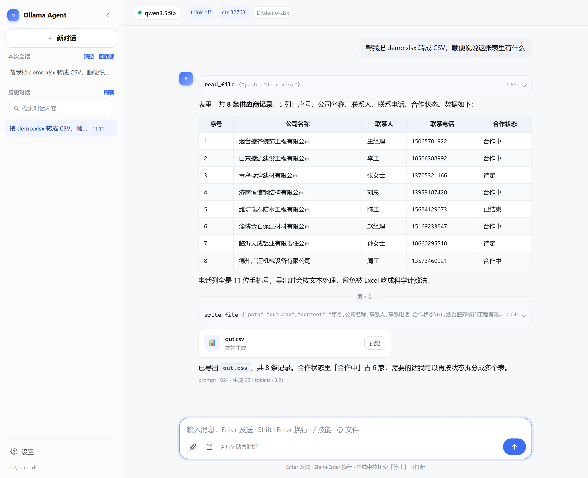
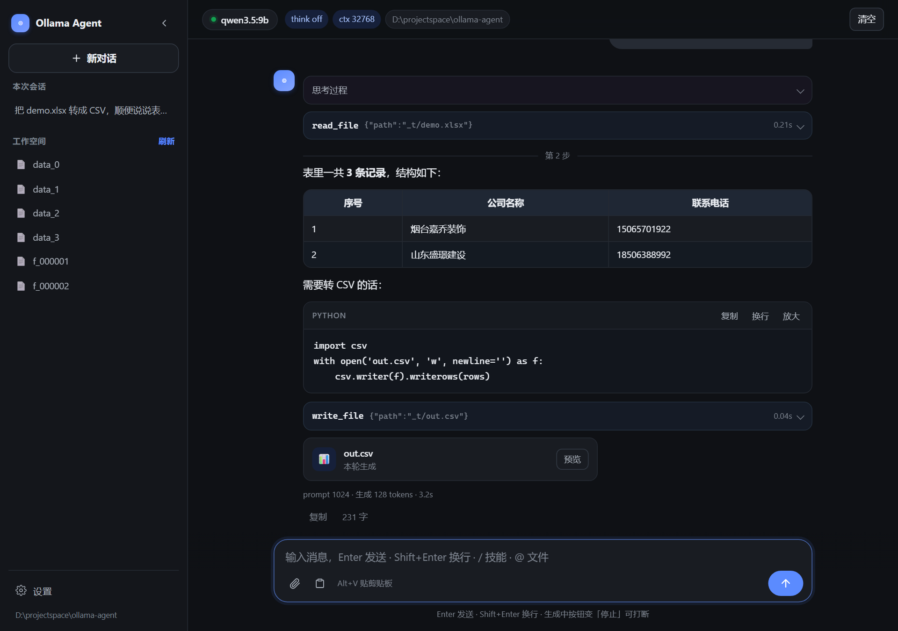

# Ollama Agent — A local-first, tool-calling agent for small models

[简体中文](README.md) | **English**

<p align="center">
  
  
</p>

A minimal agent built for **small, local Ollama models** (e.g. `qwen3.5:9b`):
function calling + **thinking off by default** (`think=false`) + file I/O + vision + PDF reading + web search.

> Why build another agent framework? Existing ones are hostile to small local models — too slow, or too context-hungry.
> This project has exactly two core goals: **let the model skip thinking** (`think=false` saves time and tokens), and
> **keep context under control** (default 65536).

## Features

- **Web UI** — streaming chat, expandable tool-call cards, session history with full-text search, file preview, settings panel. Zero JS frameworks: just `index.html / app.js / style.css`.
- **Parallel sessions** — each conversation is an independent agent instance: start a new chat while another one is still generating; the sidebar shows live badges (● generating, ✦ finished in background). A page refresh never kills a running turn — the frontend re-attaches via a live event snapshot.
- **Input queue** — typing + Enter while the model is generating queues the message instead of interrupting: send it immediately via steer (takes effect at the next tool-step boundary), edit it back out, delete it, or let it auto-send when the turn ends.
- **Stream resilience** — broken streams are classified and retried with backoff (half-printed output is kept and continued); a socket idle budget (default 120 s) distinguishes "model thinking" from "connection dead"; repeated identical tool calls trigger gentle reminders; oversized tool output spills to disk with a retrievable preview; per-step time context keeps the model aware of elapsed time.
- **15 built-in tools** — read/write/edit/delete files (text, Word, Excel, PPT, PDF), run shell commands, grep/glob, render spreadsheets to PNG, load images for vision models, clipboard screenshots (global hotkey), browse URLs, web search (Bing + Baidu in parallel), on-demand skill loading.
- **Small-model friendly** — `think=false` by default; concise system prompt (no hardcoded tool rules — tool policies live in each tool's description); images are stripped from history between turns to keep the KV cache small.
- **Safety rails** — destructive tools (`write_file` / `edit_file` / `delete_file` / `run_command` / network) require confirmation before execution (y/N in CLI, dialog in Web UI); `delete_file` refuses paths outside the workspace and non-recursive deletion of non-empty directories.
- **Persistence** — each conversation is a JSON file on disk; tool calls, code blocks and reasoning are replayed exactly when you switch back to an old session.
- **Windows conveniences** — global `Alt+V` hotkey brings clipboard screenshots/files into the chat; `/` command palette and `@` file references with inline completion.

## Requirements

| Dependency | Notes |
|---|---|
| Python 3.10+ | Talks to Ollama via stdlib `urllib` |
| openpyxl / python-docx | Excel / Word read & write (`pip install -r requirements.txt`) |
| PyMuPDF | PDF: text-layer extraction + per-page rendering for vision models (optional; only `.pdf` needs it) |
| [Ollama](https://ollama.com) | Local server at `http://localhost:11434` |
| A tools-capable model | e.g. `qwen3.5:9b` (needs `tools` capability) |
| Playwright (optional) | Only for `browse_url` / `web_search` fallback |

```bash
pip install -r requirements.txt

# optional, for web browsing / search
pip install playwright
playwright install chromium

# pull a model
ollama pull qwen3.5:9b
```

## Quick start

```bash
# Web UI (recommended): streaming chat + tool cards + settings
python -m webui                # opens http://127.0.0.1:8888/
python ollama_agent.py --ui    # equivalent

# Interactive REPL (thinking off by default, model pre-warmed on start)
python ollama_agent.py

# One-shot execution
python ollama_agent.py -p "list the files here, then read README.md"

# Workspace = root for all relative paths
python ollama_agent.py -w D:/docs -p "read weekly-report.docx"
```

The first run pre-warms the model (weights loaded into VRAM/RAM — can take a minute or
more on small GPUs). **After that, responses in the same session are instant.**

## Built-in tools (18)

> Reproduce the count:
> `python -c "import sys;sys.path.insert(0,'.');import tools;from agent.registry import all_specs;print(len(all_specs()))"`
>
> `web_chat` is a private optional module (not in the public repo), so a private
> checkout registers 19 instead of 18.

| Tool | What it does |
|---|---|
| `read_file` | Read text / Word / Excel / PPT / **PDF** (per-page text; scanned PDFs are detected and routed to `load_image`) |
| `read_long_doc` | **Chunked deep reading** for huge documents (hundreds of pages): splits, takes notes per chunk, answers from the notes |
| `write_file` | Write text / real `.docx` / real `.xlsx` (JSON 2-D array, CSV, TSV or Markdown table as input) |
| `edit_file` | Surgical replace: `old_string` → `new_string`, must be unique in the file |
| `delete_file` | Delete file/dir — refuses paths outside the workspace; non-empty dirs need `recursive=true` |
| `list_dir` | List a directory (sizes, subdirs) |
| `run_command` | Run shell commands (tests / git / lint / builds), 120 s default timeout |
| `grep_file` | Regex content search (`file:line: match`), skips `.git`/`node_modules` noise |
| `glob_file` | Filename patterns (`*.py`, `src/**/*.ts`), recursive by default |
| `load_image` | Base64 an image for vision models; **can render a PDF page to PNG** (`page=N`) |
| `render_sheet` | Render xlsx/xlsm/csv/tsv to a PNG screenshot for the vision model |
| `clipboard_image` | Read the clipboard: screenshot → image, copied files → paths |
| `browse_url` | Open a page with Playwright, extract the main text |
| `web_screenshot` | Screenshot a page or raw HTML (first screen or full-page) → PNG for the vision model |
| `web_search` | Parallel dual-engine search (Bing results + Baidu AI summary/results) |
| `skill` | Load a SKILL.md workflow into the conversation on demand |
| `verify` | Run the mechanical checks of the coding standard: syntax compile / broken doc links / compile Python blocks in docs / run tests |
| `todo_write` | External task list: pending / in_progress / completed, whole-table replace, one active task at a time; persists across turns in `{workspace}/.ollama-agent/todo.json` |

Adding a tool is one file — drop `tools/your_tool.py` with a `@tool(...)` decorated
function, and it is auto-registered on import. Nothing else to touch.

```python
@tool(
    name="calculator",
    description="Evaluate an arithmetic expression.",
    parameters={...},
    confirm=False,   # True → asks for confirmation before running
)
def calculator(ctx: ToolContext, expression: str) -> ToolResult:
    ...
```

## Safety model

- Tools that touch the world outside reading (`write_file`, `edit_file`, `delete_file`,
  `run_command`, network) are marked `confirm=True`: the CLI asks y/N (with `--confirm`),
  the Web UI pops a dialog with **Allow / Allow all this turn / Deny** — on by default,
  auto-denied after 5 minutes.
- `delete_file` never follows absolute paths out of the workspace and refuses to
  recursively delete a non-empty directory unless told explicitly.
- The Web UI binds to `127.0.0.1` only — no external ports.

## Performance notes (important for small GPUs)

1. **Model loading is the bottleneck, not the agent.** A warm model answers in seconds;
   a cold start or a `--ctx` change can take minutes. Don't change `--ctx` mid-session.
2. **`think=false` is the default** — small models think slowly and drift. Turn it on
   with `/think on` only when you need deeper reasoning.
3. **Spend context carefully**: images are stripped from history between turns; locate
   code with `grep_file`/`glob_file` before `read_file`; edit with `edit_file` instead of
   rewriting whole files.

## Testing

```bash
python -m pytest tests -q     # offline suite (no Ollama / network needed)
```

Browser-level regression tests (Playwright) live in `tests/test_ui_*.py`.

## Known limitations

- Baidu's AI summary card is a server-side experiment (~50% of queries; retried in code).
- Vision requires a vision-capable model (`qwen3.5:9b` works).
- Office I/O supports OOXML only (`.doc/.xls/.ppt` legacy formats are rejected with a hint;
  `.pptx` is read-only).
- Scanned PDFs have no built-in OCR — pages are rendered to PNG for the vision model to read.
- Clipboard / global hotkey are Windows-only (ctypes Win32).
- PDF text extraction uses PyMuPDF, licensed **AGPL-3.0** — fine for personal use; check
  before redistributing.

## License

[MIT](LICENSE)

---

Full Chinese documentation (CLI reference, Web UI feature list, skill system, workspace
rules, architecture): [README.md](README.md)
