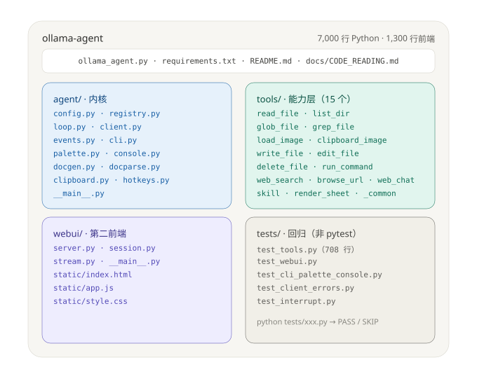
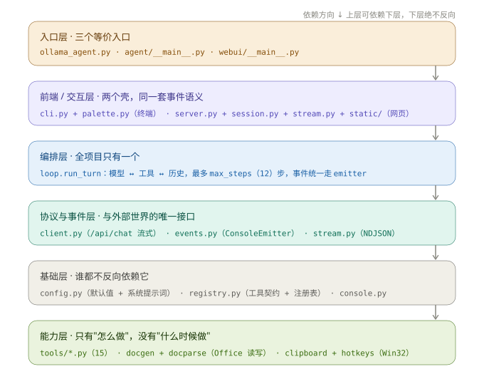
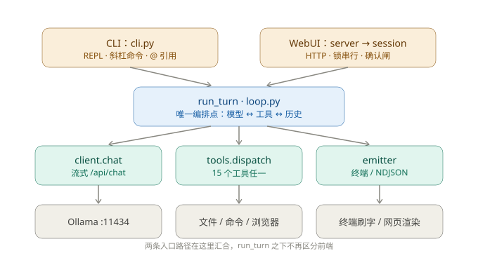
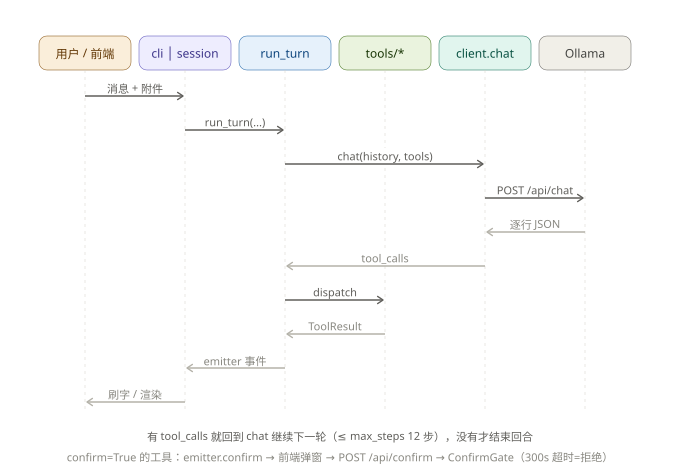

# 源码阅读与理解指南

> 面向"要读懂 + 要接着开发"的场景。读完本文应能独立回答：一条消息从输入到落盘经过了哪些函数、想加一个工具/一个前端要动哪里、哪些地方一改就会炸。
>
> 代码量：约 7000 行 Python + 1300 行前端，**四遍法、约 6–8 小时**可以吃透。
>
> 想**从零重写一遍**（而不是读现成的）→ 配套教程：[docs/tutorial/](tutorial/README.md)，12 章、多数章节一段可运行代码，最后跟本仓库对 diff。其中[第 9 章 模型侧](tutorial/09-model-side.md)讲工具 description 和系统提示词怎么写，读现成代码时也用得上。

**四张图先看一遍，再进正文：**

| 图 | 回答什么问题 | 位置 |
|---|---|---|
| [目录结构](diagrams/01-structure.svg) | 哪个目录放什么、一共多少文件 | §2.1 |
| [架构分层](diagrams/02-architecture.svg) | 六层各自负责什么、依赖朝哪个方向 | §2.2 |
| [模块调用关系](diagrams/03-call-graph.svg) | 谁调谁、两条前端在哪汇合 | §2.5 |
| [运行时序](diagrams/04-sequence.svg) | 一条消息依次经过哪些函数、什么时候回到模型 | §2.6 |

> 图都是 `docs/diagrams/*.svg`，纯手写 SVG，没有外部依赖；改图直接编辑对应文件。同名 `.png` 是 2× 位图，贴进 Word / PPT / 微信时用那个。

---

## 一、项目定位（先记住三条设计主线）

这三条决定了代码为什么长成现在这样，读代码时每条都能对上具体实现：

| 主线 | 具体体现 | 落点文件 |
|---|---|---|
| **think 可控** | 默认 `think=false` 省 token；`THINK_VALUES` 把 off/on/low..max/auto 映射成 `False/True/"low"../None`；`None` = 不传字段（兼容不支持的模型）；收到 400 且 body 含 think 时自动去掉重试 | `agent/config.py`、`agent/client.py` |
| **工具插件化** | `tools/` 下一个 `.py` = 一个工具，`@tool` 装饰器自注册，`pkgutil` 自动发现；新增工具不改任何注册表 | `agent/registry.py`、`tools/__init__.py` |
| **一处主循环，多端复用** | `run_turn` 不直接 print，全部走 `emitter`；CLI 用 `ConsoleEmitter`，WebUI 用 `StreamEmitter`（NDJSON）。加 GUI 只需再写一个 emitter | `agent/loop.py`、`agent/events.py`、`webui/stream.py` |

次要取舍：只用标准库 `urllib` 跟 Ollama 说话（不引 requests）；`http.server` 起 WebUI（不引 FastAPI）；只绑 `127.0.0.1`。

---

## 二、目录结构与文件功能（逐个文件说清）

### 2.1 目录结构（图 + 树）



蓝色=内核，绿色=能力，紫色=前端，灰色=测试——后面所有表格沿用这套配色。

```
ollama-agent/
├─ ollama_agent.py            入口①：3 行兼容壳 → agent.cli.main()
├─ requirements.txt           openpyxl + python-docx（必需）；playwright（可选）
├─ README.md                  用户视角用法手册
├─ docs/CODE_READING.md       开发视角（本文）
│
├─ agent/                     ★ 内核：配置 / 注册表 / 主循环 / 模型通信 / 交互
│  ├─ __main__.py             入口②：python -m agent → agent.cli.main()
│  ├─ config.py               默认值 + SYSTEM_PROMPT + AgentConfig（全局唯一配置对象）
│  ├─ registry.py             工具抽象 Tool / ToolContext / ToolResult + 全局注册表 + @tool
│  ├─ loop.py                 run_turn：一次用户回合的全部编排（唯一编排点）
│  ├─ client.py               兼容门面，re-export agent/backends/（老代码的 import 路径）
│  ├─ backends/               ★ 协议实现：base.py 协议无关部分 + ollama.py + openai_compat.py
│  ├─ providers.py            两种协议的 URL 拼装（/api/* 与 /v1/*）
│  ├─ userconfig.py           模型配置持久化（~/.ollama-agent/config.json）
│  ├─ probe.py                新建模型前的连通性探测（只列模型，不发对话）
│  ├─ events.py               ConsoleEmitter：终端事件输出
│  ├─ cli.py                  build_parser + main()：REPL、斜杠命令、@引用、面板/热键接线
│  ├─ palette.py              终端行内面板状态机 + raw 控制台读取（Windows）
│  ├─ console.py              ANSI 着色 + UTF-8 行缓冲
│  ├─ docgen.py               content → 真 .xlsx / .docx（写方向）
│  ├─ docparse.py             .docx/.xlsx/.pptx → 文本（读方向）
│  ├─ clipboard.py            Win32 剪贴板：截图(DIB→PNG) / 文件列表 / 缓存
│  └─ hotkeys.py              Win32 RegisterHotKey + 消息线程（Alt+V）
│
├─ tools/                     ★ 能力层：一个文件 = 一个工具，导入即注册
│  ├─ __init__.py             pkgutil 自动 import 全部模块 + 转出 registry 符号
│  ├─ _common.py              共用助手（下划线 → 不被当工具）：编码/截断/glob/遍历
│  ├─ read_file.py            读文本或调 docparse 解 Office
│  ├─ list_dir.py             列目录
│  ├─ glob_file.py            文件名模式搜索（自带 glob→regex）
│  ├─ grep_file.py            内容正则搜索
│  ├─ load_image.py           图片 → base64（给视觉模型）
│  ├─ clipboard_image.py      剪贴板截图 → 缓存文件 → base64
│  ├─ write_file.py           写文件，按扩展名路由到 docgen（confirm）
│  ├─ edit_file.py            精确替换 old_string→new_string（confirm）
│  ├─ delete_file.py          删文件/删目录（confirm）
│  ├─ run_command.py          跑 shell，超时/编码/退出码（confirm）
│  ├─ web_search.py           Bing 主 + 百度兜底，多线程抓取（confirm）
│  ├─ browse_url.py           Playwright 单例浏览器读网页（confirm）
│  ├─ web_chat.py             把问题打到文心/豆包网页版取回答（confirm）
│  ├─ skill.py                技能发现 / 索引 / 按名加载正文（含仓库内置 skills/）
│  ├─ verify.py               编码规范机械判据（语法/断链/代码块/测试）
│  └─ render_sheet.py         xlsx → HTML → 截图（给模型"看"表格）
│
├─ webui/                     ★ 第二前端（同一内核的 HTTP 外壳）
│  ├─ __main__.py             入口③：python -m webui → WebUIApp.serve()
│  ├─ server.py               ThreadingHTTPServer + 手写路由（静态/API/NDJSON）
│  ├─ session.py              AgentSession（单会话+锁）；ConfirmGate（确认闸）；RecordingEmitter（事件记账）
│  ├─ store.py                会话持久化：~/.ollama-agent/sessions/*.json
│  ├─ stream.py               StreamEmitter：事件 → NDJSON 行
│  └─ static/
│     ├─ index.html           页面骨架（引用 /static/style.css、/static/app.js）
│     ├─ app.js               全部前端逻辑：流解析、工具卡片、confirm、/ 与 @ 面板
│     └─ style.css            样式
│
├─ tests/                     ★ 回归（脚本式 main() 为主，后端/配置类用 pytest）
│  ├─ test_tools.py           18 个工具 + 路径 + xlsx/docx + 面板按键（主回归）
│  ├─ test_cli_palette_console.py  真 Windows 控制台里的面板重绘
│  ├─ test_webui.py           API + ConfirmGate + NDJSON
│  ├─ test_client_errors.py   400 分支、图片剥离、错误文本压平
│  ├─ test_interrupt.py       打断收尾、历史合法性
│  ├─ test_userconfig.py      模型配置持久化 + 探测文案（26 个用例，含诊断指路）
│  ├─ test_backends.py        pytest：两种协议拼路径 / 能力差异 / 不越界
│  ├─ test_providers.py       pytest：URL 拼装与规范化
│  ├─ test_capabilities.py    pytest：能力标记决定什么参数能下发
│  ├─ test_ui_models.py       Playwright：模型管理界面（新建→测连通→保存→编辑→删除）
│  ├─ test_ui_ws_files.py     Playwright：工作空间文件列表位置与预览
│  ├─ test_ui_sidebar.py      Playwright：侧栏收起/展开/窄屏
│  ├─ test_sessions.py        多会话持久化 + 搜索 + 接口
│  └─ test_ui_search.py / test_ui_reset.py   历史搜索 / 清空对话
│
└─ evals/                     ☆ 需要模型的评测（辅助工具，不属于上面四层）
   └─ tool_hit.py             工具命中率：20 条用户话术 → 期望工具，只问不执行，约 14 分钟
```

`evals/` 与 `tests/` 的分工：`tests/` 一律不连模型、5 秒跑完；`evals/` 必须连 Ollama，测的是"模型会不会选对工具"（见教程[第 9 章](tutorial/09-model-side.md)）。改 description 或系统提示词后跑 `evals/`，改代码逻辑后跑 `tests/`。

### 2.2 架构分层（六层，依赖只朝下）



| 层 | 文件 | 只负责 | 判据（出现这些行为就说明放错层） |
|---|---|---|---|
| 入口 | `ollama_agent.py`、`agent/__main__.py`、`webui/__main__.py` | 把 argv 变成一次调用 | 出现业务逻辑 |
| 前端/交互 | `cli.py`、`palette.py` / `server.py`、`session.py`、`stream.py`、`static/` | 收输入、显示输出、会话状态 | 自己实现"模型↔工具"循环 |
| 编排 | `loop.py` | 一个回合的全部决策（何时问模型、何时跑工具、何时收尾） | 出现 print、HTTP、文件 IO 细节 |
| 协议/事件 | `client.py`、`events.py`、`stream.py` | 与 Ollama 通信；把事件变成终端/NDJSON | 出现界面文案或业务判断 |
| 基础 | `config.py`、`registry.py`、`console.py` | 默认值、工具契约、着色与编码 | import 上层模块 |
| 能力 | `tools/*.py`、`docgen/docparse`、`clipboard/hotkeys` | 单个动作"怎么做" | 决定"什么时候做"（那是 loop 的事） |

记住一句话：**"什么时候做"归 `loop.py`，"具体怎么做"归 `tools/`，"怎么显示"归 emitter。** 三者混在一起就是这类项目失控的开始。

### 2.3 四个目录的边界（该放什么、不该放什么）

| 目录 | 只负责 | 明确不做 | 依赖谁 |
|---|---|---|---|
| `agent/` | 编排、协议、交互、Office/剪贴板底层 | 不放具体工具（工具全在 `tools/`） | `agent/registry.py` 是全局最底层，不依赖任何内部模块 |
| `tools/` | 每个工具的"怎么做" | 不写 UI、不碰 `history`、不改 `cfg` | 只依赖 `agent.registry`（+ `_common`、`docgen/docparse`） |
| `webui/` | HTTP 外壳 + 会话状态 | 不复制主循环逻辑（一律调 `run_turn`） | `agent.loop` / `agent.config` / `agent.client` |
| `tests/` | 可独立运行的回归 | 不引入 pytest 夹具，不依赖真实模型 | 直接 import 被测模块 |

### 2.4 文件级明细（关键符号 = 读代码时的抓手）

**内核四件（决定 agent 行为，必读）**

| 文件 | 行 | 关键符号 | 具体做什么 | 被谁用 |
|---|---|---|---|---|
| `agent/config.py` | 74 | `SYSTEM_PROMPT`、`THINK_VALUES`、`MAX_CTX`、`AgentConfig` | 默认模型 `qwen3.5:9b`、默认 ctx 65536（上限 1048576）、12 步上限；系统提示词 8 条规则 | 所有模块 |
| `agent/registry.py` | 117 | `ToolResult`、`ToolContext.resolve/approve`、`Tool.run/spec`、`@tool`、`dispatch` | 工具契约 + 全局注册表；`resolve()` 定义"相对路径锚定工作空间" | loop、所有 tools |
| `agent/loop.py` | 164 | `new_history`、`run_turn`、`strip_old_images`、`pad_unanswered_tool_calls` | 拼系统提示 + 技能索引；跑最多 `max_steps` 步"模型↔工具"循环 | cli、webui.session |
| `agent/backends/base.py` | 449 | `ChatClient`、`StreamParser`、`error_text` | 协议无关部分：连接/中断/流读取/重试；能力标记 `supports_*` 默认 False | 两个具体后端 |
| `agent/backends/ollama.py` | 132 | `OllamaClient`、`OllamaStreamParser` | `/api/chat` 原生协议；整行 JSON + `done` 帧；四项能力全 True | 工厂 |
| `agent/backends/openai_compat.py` | 158 | `OpenAICompatClient`、`OpenAIStreamParser` | `/v1/chat/completions`；SSE + `[DONE]`；tool_call 参数分片累积；能力全 False | 工厂 |
| `agent/backends/openai_messages.py` | 109 | `to_openai_messages` | 消息格式转换：`tool_call_id` 复用、图片转 data URL | openai_compat |
| `agent/client.py` | 33 | 仅 re-export | 历史兼容门面，实现在 `agent/backends/` | 老代码 |
| `agent/providers.py` | 88 | `endpoint`、`normalize_host` | 两种协议的 URL 拼装（`/api/*` vs `/v1/*`），拼错就是 404 的唯一来源 | backends、`agent/probe` |
| `agent/userconfig.py` | 268 | `ConfigStore.load/save/get_profile/upsert_profile/delete_profile`、`mask_key`、`to_agent_patch`、`BUILTIN_ID` | 模型配置持久化到 `~/.ollama-agent/config.json`；`profiles` 记「连哪个模型」，`ui` 记使用习惯；内置 Ollama 是**虚拟条目**不落盘；Key 明文存盘但对外只给打码 | `webui/session` |
| `agent/probe.py` | 171 | `probe`、`_parse_models`、`_is_loopback` | 新建模型前测连通：只打 `GET /v1/models` 或 `/api/tags`，不发对话请求；失败按 `url/auth/connect/http/parse` 分开报并附 `hint`；本机地址报 502 时点明「多半是本地服务没起或代理拦了本机」 | `webui/server` 的 `/api/models/probe` |

**交互与入口**

| 文件 | 行 | 关键符号 | 具体做什么 | 被谁用 |
|---|---|---|---|---|
| `agent/cli.py` | 611 | `build_parser`、`main`、`resolve_at_refs`、`find_context_files`、`do_paste`、`do_skill` | 参数→`AgentConfig`；REPL 主循环；斜杠命令分发；`@` 引用解析；面板与热键接线 | 两个入口文件 |
| `agent/palette.py` | 445 | `trigger_token`、`PaletteState`、`read_line`、`_read_line_raw`、`_redraw`、`_enable_vt` | 敲 `/` 或 `@` 后弹出候选；↑↓/Enter/Esc；按显示宽度截断重绘 | cli（`--no-palette` 关闭） |
| `agent/events.py` | 76 | `ConsoleEmitter`（8 个核心方法 + 可选 `thinking`） | `run_turn` 的所有输出都走这里 | loop 默认 emitter |
| `agent/console.py` | 29 | `setup_stdio`、`color` | UTF-8 + 行缓冲；ANSI 包装 | cli、client、events、palette |

**IO 与系统底层**

| 文件 | 行 | 关键符号 | 具体做什么 | 被谁用 |
|---|---|---|---|---|
| `agent/docgen.py` | 399 | `parse_table_content`、`_validate_rectangular`、`write_xlsx`、`write_docx` | JSON 二维数组优先 → 表格；Markdown 子集 → docx | `tools/write_file` |
| `agent/docparse.py` | 150 | `is_text_file`、`extract_text`、`_docx_text`、`_xlsx_text`、`_pptx_text` | Office → 纯文本；`LEGACY_SUFFIXES`/`SHEET_SUFFIXES`/`DOC_SUFFIXES` 判定 | `tools/read_file`、`tools/write_file` |
| `agent/clipboard.py` | 338 | `grab_any`、`grab_files`、`grab_and_cache`、`dib_to_rgba` | 剪贴板取图/取文件，落 `.clip_cache/` | cli `do_paste`、webui、`tools/clipboard_image` |
| `agent/hotkeys.py` | 110 | `HotkeyListener.start/stop`、`is_supported` | 全局 Alt+V；注册失败返回 False（调用方降级为 `/paste`） | cli、webui.server |

**工具层（18 个，签名统一 `fn(ctx, **参数) -> ToolResult`）**

| 工具 | 文件 | 入参 | 行为要点 |
|---|---|---|---|
| `read_file` | `tools/read_file.py` | `path, offset=0, limit=200` | 文本按行窗口；Office 走 docparse；二进制给提示 |
| `list_dir` | `tools/list_dir.py` | `path=""` | 列目录（默认工作空间） |
| `glob_file` | `tools/glob_file.py` | `pattern, path=None` | `*.py` 自动递归；结果相对路径 |
| `grep_file` | `tools/grep_file.py` | `pattern, path=None, glob=...` | 正则逐行；解码 utf-8→gbk |
| `load_image` | `tools/load_image.py` | `path` | 校验魔数（`sniff_image`）后 base64 给视觉 |
| `clipboard_image` | `tools/clipboard_image.py` | `save_as=""` | 剪贴板 → 缓存文件 → base64 |
| `write_file` | `tools/write_file.py` | `path, content` | 按扩展名路由 docgen；旧格式 `.xls/.doc` 明确拒绝 |
| `edit_file` | `tools/edit_file.py` | `path, old_string, new_string, count?` | 必须唯一匹配，否则报错让模型重试 |
| `delete_file` | `tools/delete_file.py` | `path, recursive=False` | 删前统计数量/大小回显 |
| `run_command` | `tools/run_command.py` | `command, cwd=None, timeout=...` | 子进程 + 超时 + 退出码 + 输出截断 |
| `web_search` | `tools/web_search.py` | `query, max_results=6` | Bing 三试 → 判垃圾 → 百度兜底 → 去重 |
| `browse_url` | `tools/browse_url.py` | `url, max_chars=12000` | Playwright 单例复用；对外暴露 `pw_new_page` |
| `web_chat` | `tools/web_chat.py` | `question, site="both"` | 复用浏览器单例问文心/豆包，轮询稳定后抽取 |
| `skill` | `tools/skill.py` | `name="", max_chars=20000` | 空 name 列技能；有 name 注入正文 |
| `render_sheet` | `tools/render_sheet.py` | `path, sheet="", max_rows=...` | 表格 → HTML → 截图，返回图片给视觉模型 |
| `verify` | `tools/verify.py` | `checks, path=None, timeout=120` | 编码规范机械判据：syntax/links/blocks/tests，返回真实退出结果 |

**Web UI**

| 文件 | 行 | 关键符号 | 具体做什么 |
|---|---|---|---|
| `webui/server.py` | 592 | `make_handler`、`WebUIApp.serve/start_hotkey`、`_safe_list_models` | 路由表：`/`、`/static/*`、`/api/{health,config,pending,skills,files,models,sessions}`（GET）；`/api/{chat,config,confirm,reset,stop,paste,upload,models/probe,models/save,models/activate,models/delete,sessions/new,sessions/open,sessions/delete}`（POST）。列模型走 `_safe_list_models` 带 6s 预算，超时返回空而不是把设置面板卡住 |
| `webui/session.py` | 815 | `AgentSession.run/request_stop/update_config/profiles_view/save_profile/activate_profile/delete_profile`、`RecordingEmitter`、`ConfirmGate.ask/answer/reject_all` | 单会话 + `threading.Lock` 串行跑回合；启动时按 `active` 恢复上次的模型配置；回合事件边转发边记账，回合结束落盘；确认闸用 `Event` 阻塞、300s 超时拒绝。**锁的纪律**：只在改配置数据时持锁，应用配置（`_apply_profile`→`update_config`）必须放锁外，否则不可重入锁自己锁死自己 |
| `webui/store.py` | 261 | `SessionStore.list/load/save/create/delete/purge_empty/search`、`make_title` | 一条对话一个 JSON（history 给模型、turns 给界面回放）；临时文件 + `os.replace` 原子写；空会话不进列表；`search()` 扫 turns 正文（提问/回答/思考/工具），多词 AND，片段带上下文 |
| `webui/stream.py` | 82 | `StreamEmitter`（8 方法 + `confirm`） | 事件写 NDJSON；写失败判断连 → 回调 `request_stop` |
| `webui/static/app.js` | 1850 | `send()`、事件 switch、面板、上传、设置、`loadModels/renderBuiltin/renderCustom/openModelForm/probeModel/saveModel` | 解析 NDJSON 逐事件渲染；`/` `@` 面板与 CLI 同语义；设置抽屉两个标签页（模型管理/偏好），模型管理区分「内置」与「自定义」两块 |

### 2.5 模块调用关系（静态：谁调谁）



两条入口路径在 `run_turn` 处汇合，**它之下不再区分前端**——这是这个项目最值钱的一个决定。

实际的 import 边（严格单向，没有循环）：

```
cli.py        → client, config, console, loop, registry, palette(懒), tools.skill(懒)
webui/server  → config, session, stream, tools
webui/session → client, config, loop, registry
loop          → client, config, events, registry, tools
client        → console, config
events        → console
tools/*       → registry  (+ _common / docgen / docparse / browse_url)
registry      → （无内部依赖，最底层）
```

两条容易忽视的边：
- `loop.py` 顶部 `import tools` —— 这一句是**注册副作用**（触发 18 个 `@tool`），不是普通依赖。
- `tools/web_search.py` 和 `web_chat.py` 借用 `tools/browse_url.py` 的 Playwright 单例（`_pw_page` / `pw_new_page`），所以浏览器全进程只有一个。

### 2.6 运行时序（一条消息依次经过谁）



上面这张是"一条消息的完整生命周期"。下面是两个前端从入口到 `run_turn` 的装配差异。

**CLI**

```
cli.main → build_parser → AgentConfig → make_context(ToolContext) → new_history
  → client.warmup()
  → while True: palette.read_line / input
      → resolve_at_refs()                    # @文件 → 图片base64/文件路径
      → run_turn(client, cfg, ctx, history, send_text, imgs)
          → client.chat() → 流式回调 emitter.text/think
          → tools.dispatch(name,args,ctx) → Tool.run → handler
          → emitter.tool_call / tool_result
```

**WebUI**（第 2 步开始分叉，第 4 步汇合到同一个 `run_turn`）

```
app.js send() → POST /api/chat
  → server.Handler.handle_chat → AgentSession.run (with lock)
      → run_turn(..., emitter=StreamEmitter, cancel=cancel_event)   # ← 同一个内核
  → StreamEmitter._send → NDJSON 行 → app.js 逐行渲染
工具 confirm=True → ctx.ask → ConfirmGate.ask (阻塞)
  → emitter.confirm → 浏览器弹窗 → POST /api/confirm → gate.answer → Event.set
  （300s 无人应答 → 自动拒绝；CLI 侧同一位置换成了 input() 的 y/N）
```

这是全项目**唯一**一条"从 HTTP 线程回到回合线程"的通路，也是 `request_stop()` 必须不取会话锁的原因（回合线程正持锁阻塞在 `Event.wait` 上）。

---

## 三、三条启动命令与初始化顺序

三条命令指向同一套装配，区别只在装配完之后循环怎么跑：

| 命令 | 入口 | 装配后进入 |
|---|---|---|
| `python ollama_agent.py` / `python -m agent` | `agent.cli.main` | REPL 循环 |
| `... -p "..."` | 同上 | 只跑一次 `run_turn`；`KeyboardInterrupt` → exit 130 |
| `python -m webui` / `--ui` | `webui.__main__.main` 或 `cli.main` | `WebUIApp.serve()` 起 `ThreadingHTTPServer` |

`cli.main` 的装配顺序（读代码时对着这 6 步）：

```
build_parser → AgentConfig
  → make_context()        # ToolContext(workspace, confirm, ask)
  → new_history()         # 系统提示 + "当前工作空间: X" + 技能索引
  → client.warmup()       # 预热，避免首回合干等加载
  → hotkey.start()        # 可选，失败只降级为 /paste
  → while True:
        palette.read_line()            # 或 input()
        ├─ "/xxx"  斜杠命令 → 直接 print / 改 cfg·client / 注入技能
        ├─ "@xxx"  resolve_at_refs()   # 模糊匹配 → 图片转 base64 / 文件转路径
        └─ run_turn(client, cfg, ctx, history, send_text, imgs)
```

WebUI 侧相对 CLI 只多两件事：`AgentSession` 用锁把回合串行化；`ConfirmGate` 把"要不要执行"抛给浏览器（链路见 §2.6）。

---

## 四、核心数据流：一次 `run_turn` 的生命周期

`history` 就是 Ollama 要求的 messages 数组，全程只有这一个结构：

```python
[{"role":"system",   "content": SYSTEM_PROMPT + workspace + 技能索引},
 {"role":"user",     "content":"...", "images":[...]?},
 {"role":"assistant","content":"...", "tool_calls":[{"function":{"name":...,"arguments":{...}}}]?},
 {"role":"tool",     "content":"工具结果文本", "tool_name":..., "images":[...]?},
 ...]
```

回合内循环（`for step in range(1, max_steps+1)`）：

1. `emitter.step(n)`
2. `client.chat(...)` 流式收：`on_think` → `emitter.think`，`on_text` → `emitter.text`，
   `on_wait` → `emitter.thinking`（可选，长工具参数生成期间的每秒心跳）；
   返回 `{thinking, content, tool_calls, stats, cancelled, error}`
2.5 `emitter.stats(st, step=n)` —— **每步各报一次**（只报一次的话，生成 9000 字符
   工具参数那一步的耗时会从界面上消失）
3. 无 `tool_calls` → 记 `final_text`，break
4. 有 → 先 append assistant（带 `tool_calls`），再逐个 `tools.dispatch(name, args, ctx)`
5. 每个结果包成 `{"role":"tool", "content":..., "tool_name":...}` append 回去
6. 环满 `max_steps` → `[已达到最大工具步数，强制结束]`

**四个必须理解的保护逻辑**（删掉任意一个，Ollama 就会 400 或对话崩）：

| 保护 | 位置 | 为什么必须有 |
|---|---|---|
| `strip_old_images` | 回合开头 | 历史里的 base64 图片极吃 context；只保留本回合的图 |
| `pad_unanswered_tool_calls` | `KeyboardInterrupt` 分支 | assistant 声明了 tool_calls 却没有对应 tool 消息 → 下一次请求被 Ollama 拒 |
| `cancelled` 分支 | `client.chat` 返回后 | 断流时 tool_calls 可能不完整，必须整体丢弃，只保留部分文本并标注"已打断" |
| tool_calls 按下标合并 | `client.chat` | 流式下 name/arguments 分片到达；arguments 可能是 dict，也可能是 JSON 字符串（先攒 `_raw` 最后 `json.loads`） |

工具执行本身永远不会把 agent 炸掉：`Tool.run()` 用 `inspect.signature` 过滤未知参数，`except Exception` 统一转成 `[工具执行错误] name: Type: msg` 回传给模型自己改。

---

## 五、四遍阅读路线（按此顺序，别乱跳）

### 第 1 遍：内核 2 小时 —— 读 4 个文件

`config.py` → `registry.py` → `loop.py` → `client.py`

读完应能回答：
- `AgentConfig` 里哪些字段是"改了要同步到 client"的？（`model`/`think`/`num_ctx`/`temperature`——CLI 命令和 `update_config` 都在做双写）
- `ctx.resolve()` 对相对路径、绝对路径、`~`、空串分别怎么处理？
- `run_turn` 在什么条件下会提前 `return` 而不是 `break`？（打断且跳过未执行工具时）
- `client.chat` 的两个自动重试分别触发于什么 body？

### 第 2 遍：交互与前端 2 小时

`events.py` → `cli.py` → `webui/session.py` → `webui/server.py` → `webui/stream.py` → `static/app.js`（跳着看 `fetch('/api/chat')` 那段）

读完应能回答：
- 加一个 CLI 斜杠命令要动哪几处？（`HELP_TEXT` + `while` 里的 `elif` 分支 + 可选 `palette.py` 的 `_build` 指令表）
- `@` 引用多命中时 CLI 和 WebUI 的处理差异？（CLI 弹编号选择 / WebUI 前面板选）
- 为什么 `request_stop()` 不取会话锁？（回合线程正持锁阻塞在 `Event.wait`，取锁即死锁）
- 浏览器直接关页会发生什么？（`StreamEmitter._send` 捕获 `BrokenPipe` → `on_disconnect` → `request_stop`）

### 第 3 遍：工具与 IO 2 小时

`tools/__init__.py` → `tools/_common.py` → `write_file.py` + `docgen.py` → `read_file.py` + `docparse.py` → `run_command.py` / `edit_file.py` / `grep_file.py` → `palette.py` → `clipboard.py` / `hotkeys.py`

读完应能回答：
- 新增一个工具最少写几行？（一个 `@tool(...)` 装饰的函数；自动发现靠 `pkgutil.iter_modules`，下划线开头会被跳过）
- `.xlsx` 落盘前怎么防错位？（`_validate_rectangular`：每行列数必须等于首行列数，否则抛 `ValueError` → 经 `write_file` 返回给模型重写）
- `run_command` 怎么处理超时和编码？（`timeout` + `decode_text` 的 utf-8→gbk 顺序）
- 面板为什么只在 Windows + TTY + VT 支持下开启？（`_enable_vt()` 失败就回退 `input()`）

### 第 4 遍：测试与边界 1 小时

`tests/test_tools.py`（主回归）→ `test_client_errors.py` → `test_interrupt.py` → `test_webui.py` → `test_cli_palette_console.py`

这些**不是 pytest**，都是自带 `main()` 的脚本，直接 `python tests/test_tools.py` 跑，打 `PASS`/`SKIP`：

| 测试 | 手段 | 覆盖 |
|---|---|---|
| `test_tools.py` | 现场造 docx/xlsx fixture | 注册表、路径解析、读写/编辑/删除、run_command 退出码/超时/确认闸、grep/glob、xlsx 错位拦截、面板按键驱动（`_read_line_raw` 注入 key getter） |
| `test_client_errors.py` | 替换 `urlopen` 返回 400 | `_error_text` 嵌套错误压平、图片剥离重试、其它 400 不重试 |
| `test_interrupt.py` | 假流式响应 + `cancel` | 打断后历史合法性、`pad_unanswered_tool_calls` |
| `test_webui.py` | 起 server 线程 + urllib 打 API | config/chat/confirm/stop/upload/skills/files |
| `test_cli_palette_console.py` | 真 Windows 控制台 + 注入按键 | 面板重绘、宽度截断、附件行 |
| `test_ui_sidebar.py` | Playwright 点真页面 | 侧栏收起后可再展开（窄轨 / 抽屉 / Ctrl+B） |

---

## 六、扩展点清单（开发时的改动半径）

| 想做的事 | 改哪里 | 注意 |
|---|---|---|
| **加工具** | 新建 `tools/your_tool.py`，`@tool(...)` | 参数 schema 里每个参数都要有 `description`（小模型靠它选工具）；危险操作加 `confirm=True`；路径一律 `ctx.resolve()` |
| **加前端** | 实现与 `ConsoleEmitter` 同名的方法（step/text/think/newline/tool_call/tool_result/stats/notice，可选 confirm 和 thinking） | 已有 GUI 想法时，`run_turn(emitter=你的)` 即可；`stats` 要接受 `step` 参数，否则长工具调用的耗时又会消失 |
| **加技能** | `{workspace}/.workbuddy/skills/<name>/SKILL.md`、`~/.workbuddy/skills/`，或仓库内置 `skills/<name>/SKILL.md` | frontmatter 的 `name/description` 进索引常驻，正文由 `skill` 工具按需加载；三个目录同名时**先者胜**（工作空间 > 用户 > 仓库内置），内置技能因此可被用户覆盖 |
| **换模型 / 调 ctx / 改 think** | `AgentConfig` + `client` 对应字段 | 两边必须同步：`cli.py` 的 `/model` `/ctx` `/think` 与 `session.update_config()` 都在双写 |
| **加 WebUI 接口** | `webui/server.py` 的 `do_GET/do_POST` 路由分支 | 纯标准库手写路由，没有框架；静态资源在 `webui/static/` |
| **改系统提示词** | `agent/config.py` 的 `SYSTEM_PROMPT` | 现有第 8 条是 xlsx 列表格规约，改前先跑 `tests/test_tools.py` 的 xlsx 用例 |

---

## 七、改动前必须知道的 8 个坑

1. **tool_calls ↔ tool 消息必须配对**，否则下一轮 Ollama 直接 400。任何新增的"中途退出"分支都要走 `pad_unanswered_tool_calls` 或补占位。
2. **图片只在本回合有意义**：`strip_old_images` 会在下一回合把它们从历史里剥掉，不要指望模型记得上一张图。
3. **`num_ctx` 一改就触发模型重载**（几十秒到几分钟），CLI `/ctx`、WebUI 设置面板都提示了，别在循环里改。
4. **WebUI 是单会话单锁**：一个 `AgentSession`、一个 `threading.Lock`，两个浏览器标签同时发消息会排队。要做多会话得改成 session 表 + 每会话一把锁。
5. **`ConfirmGate` 的 300s 超时是 fail-safe**（默认拒绝），改小容易误拒，改大容易挂住回合线程。
6. **面板（palette）依赖 Win32 控制台**：非 Windows / 非 TTY / VT 不支持时自动回退 `input()`，改面板逻辑时保持这条回退路径可用。
7. **工具异常被吞成文本**：调试工具时看不到 traceback，先临时改成 `raise` 或直接单测工具函数。
8. **双开限制**：WebUI 端口唯一（`--port` 错开）、全局 Alt+V 只允许一个进程注册（第二个加 `--no-hotkey`）、同 workspace 并发写文件无锁。

---

## 八、后续开发建议（按投入产出排序）

| 优先级 | 方向 | 动机 | 落点 |
|---|---|---|---|
| P0 | **tool_calls 增量容错** | 小模型流式下 arguments 常被截断/漏尾，现在只能在结束后 `json.loads` 兜底 | `client.chat` 的合并逻辑 |
| P0 | **历史压缩 / 自动摘要** | 长对话迟早爆 ctx；现在只有 `/save` `/load`，没有自动裁剪 | `loop.run_turn` 入口 |
| P1 | **工具沙箱** | `ctx.resolve` 允许绝对路径写到工作空间外，CLI 无提示（WebUI 有确认闸） | `registry.ToolContext.resolve` / `Tool.run` |
| P1 | **多标签 / 并发回合** | 已做「多会话留存与切换」（`webui/store.py`），但同一时刻仍只跑一个回合；两个标签页会互相排队 | `webui/session.py` 的锁粒度 |
| P2 | **pytest 化 + CI** | 现在是脚本 `main()`，无法 `-k` 筛选、没有覆盖率 | `tests/` |
| P2 | **结构化日志 / 回合回放** | 出问题只能看终端回滚，没有持久化事件流 | `events.py` 加一个 `FileEmitter` |

---

## 九、一页速查

```
入口:  ollama_agent.py | python -m agent | python -m webui | --ui
内核:  run_turn(loop.py) ← client.chat(client.py) ← /api/chat ; dispatch(registry.py) → tools/*
提示:  SYSTEM_PROMPT(config.py) + 工作空间 + skill_index(skill.py)
历史:  [{system}, {user,images?}, {assistant,tool_calls?}, {tool,tool_name,images?}...]
输出:  emitter: ConsoleEmitter(CLI) / StreamEmitter(NDJSON) —— 加前端只实现这 8 个方法(+confirm/thinking)
安全:  confirm=True 工具 → ctx.ask → CLI input / WebUI ConfirmGate(300s 超时=拒绝)
路径:  ctx.resolve(): 相对 → workspace；绝对/~ → 原样
测试:  python tests/test_tools.py 等，脚本式，看 PASS/SKIP
```
