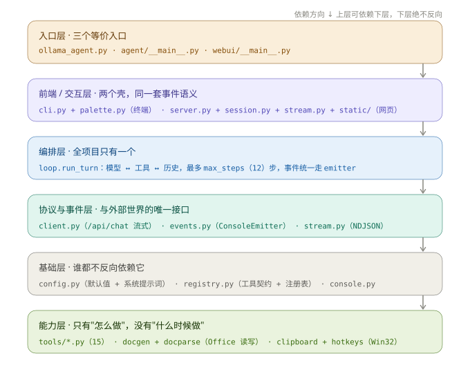

# 第 0 章 · 先想清楚，再写第一行

**本章产出**：一张属于你自己的架构草图（纸上画也行），以及四个已经拍板的决策。代码 0 行。

---

## 一、为什么先做决策

写 agent 跟写普通 CRUD 不一样：它的"业务逻辑"是**模型决定的**，你在写一个给模型用的运行时。

这带来一个特殊后果：**结构错一点，后面每一步加功能都会翻倍还债。** 举三个真实会发生的例子：

| 一开始偷的懒 | 三个月后要付的账 |
|---|---|
| `run_turn` 里直接 `print("正在调用工具…")` | 想加 WebUI 时，得把整个循环抄一遍，然后两份分叉 |
| 工具函数自己 `open("data.txt")` | 用户在 A 目录启动，模型读的是 B 目录；想切工作空间得改所有工具 |
| 没管 `tool_calls` 和 `tool` 消息的配对 | 用户按一次 Ctrl+C，下一轮请求 Ollama 直接 400，而且**历史已经坏了，只能 `/reset`** |

这三笔账在本仓库里对应的解法，就是下面四个决策。它们决定了后面 1500 行的形状，值得花 40 分钟想清楚。

---

## 二、四个必须先回答的问题

### 决策 1：谁来跑那个循环？

模型一次回答只能给你"要调用什么工具"，它**不会自己再问一次**。所以必须有代码做这件事：

```python
while 还有工具要调:
    调模型 → 拿到 tool_calls → 执行 → 结果塞回历史 → 再调模型
```

| 方案 | 优点 | 为什么不用 |
|---|---|---|
| 用 LangChain / LlamaIndex 的 agent | 现成 | 你没法控制打断时机、拿不到中间事件、出错时栈有 20 层；而且它的抽象是为了"兼容 50 个模型"，你只有一个 |
| 用 Ollama 官方 `ollama` Python 包 | 封装好 | 它把流式、tool_calls 合并都藏起来了，看不见就改不动 |
| **自己写，`urllib` 直连 `/api/chat`** ✅ | 协议全透明，每一步可观测 | 要自己处理流式解析和合并（第 2、4 章） |

**拍板**：自己写。代价约 150 行协议代码，换来的是"任何一步都能打断、能记日志、能换模型"。

### 决策 2：工具怎么描述给模型？

模型不认识你的 Python 函数，它只认 JSON Schema。工具 = **名字 + 自然语言描述 + 参数 Schema + 一个执行函数**。

| 方案 | 优点 | 为什么不用 |
|---|---|---|
| 从函数签名 + 类型注解自动生成 Schema | 少写样板 | 描述只能是 docstring，写不出"什么时候该用它、什么时候不该用"；参数约束（枚举、范围）也表达不了 |
| 一个巨大的 `TOOLS = [...]` 列表 + 一坨 `if name == ...` 分支 | 集中 | 加第 10 个工具时那个函数 500 行，两个人同时改必冲突 |
| **一个工具一个文件 + `@tool` 装饰器自注册 + `pkgutil` 自动发现** ✅ | 加工具 = 新建 1 个文件，零改其他地方 | 工具之间的公共代码要有地方放（→ `_common.py`） |

**拍板**：装饰器自注册。这是整个项目最值得抄的一个设计 —— 它把"扩展"从"改代码"变成"加文件"。

### 决策 3：状态放在哪？

agent 需要记的东西：对话历史、配置、工作空间路径、确认回调。

| 方案 | 问题 |
|---|---|
| 一个 `Agent` 大类，全塞进去 | 主循环和状态耦合，测试时没法只测循环；WebUI 想要两个会话就得改类 |
| 全局变量 | WebUI 多线程下直接崩 |
| **`history` 列表 + `AgentConfig` + `ToolContext`，全部显式当参数传** ✅ | 参数有点长（5 个），但每个函数都能单独测 |

**拍板**：**没有 `Agent` 类**，只有一个函数 `run_turn(client, cfg, ctx, history, text, ...)`。状态全在参数里，谁能改什么一目了然。

> 注意 `ToolContext` 是唯一"注入"：工具需要的运行时信息（工作空间、确认开关）都从这里拿，**不给工具传 config、不给工具传历史**。这条约束让 `tools/` 目录永远不依赖上层。

### 决策 4：输出怎么出去？

主循环要告诉外界很多事：开始第几步了、模型正在吐字、要调哪个工具、工具返回什么、token 用了多少。

| 方案 | 问题 |
|---|---|
| 直接 `print` | 只有终端能看；WebUI 要么抄循环，要么 hacking `sys.stdout` |
| 回调函数 `on_event(type, data)` | 一个 dict 传天下，前端得 `if type ==` 几十次，加事件无感知 |
| **emitter 对象，每个事件一个方法** ✅ | 要实现的接口有 8 个，但 IDE 能补全、少一个方法立刻报错 |

**拍板**：`ConsoleEmitter` / `StreamEmitter` 两个实现，主循环只认接口（第 5 章）。加一个 GUI 前端 = 实现 8 个方法，**不改主循环一行**。

---

## 三、由此得到的骨架

四个决策定完，结构就唯一了：



```
入口     ollama_agent.py / python -m agent / python -m webui
   ↓
前端     cli.py（REPL）        webui/（HTTP + NDJSON）
   ↓             ↘         ↙
编排            run_turn（唯一的循环）
   ↓
协议     client.py（/api/chat）   events.py（输出接口）
   ↓
基础     config.py   registry.py   docgen / docparse / clipboard ...
   ↓
能力     tools/*.py（15 个，只依赖 registry）
```

**依赖只朝下，不朝上。** 三条具体禁令：

1. `tools/*.py` 不许 import `agent.config` / `agent.loop` / `agent.cli` —— 工具不该知道"谁在用它"
2. `webui/` 不许复制主循环 —— 想加逻辑就加到 `run_turn` 里，两个前端共享
3. `registry.py` 不许 import 上层 —— 它是底座，`loop.py` 顶部那句 `import tools` 是**注册副作用**，不是依赖

判断代码放错层的方法：**出现下面这些行为，就是放错了。**

| 症状 | 应该在哪 |
|---|---|
| 一个 `tools/xxx.py` 里出现 `print` | 用 `ToolResult` 返回文本，让人去看 |
| `run_turn` 里出现 `print` / `sys.stdout` | emitter |
| `client.py` 里出现 `history.append` | 它只负责一次 HTTP 往返，不碰状态 |
| `server.py` 里出现 `if tool_calls` | 那是循环的事 |

---

## 四、三条不变量（Invariants）

这三条不是"最佳实践"，是**协议硬约束**。破一条，agent 立刻坏，而且报错信息极难懂。

### 不变量 1：`tool_calls` 和 `tool` 消息必须一一配对

Ollama 收到的消息序列长这样：

```json
[
  {"role": "user", "content": "读一下 README"},
  {"role": "assistant", "content": "", "tool_calls": [
      {"function": {"name": "read_file", "arguments": {"path": "README.md"}}}]},
  {"role": "tool", "content": "…文件内容…", "tool_name": "read_file"},
  {"role": "assistant", "content": "这个项目是…"}
]
```

如果 assistant 声明了 1 个 `tool_call`，后面却没有对应的 `tool` 消息，**下一次请求直接 400**，而且这个坏历史会一直留在 `history` 里，导致之后每一轮都失败。

什么时候会缺？**打断**。用户按 Ctrl+C、关网页、模型 stream 断掉 —— 这时 assistant 消息可能已经进历史了，工具还没跑。所以 `loop.py` 里必须有两个补写函数：

```python
pad_unanswered_tool_calls(history)   # 打断收尾：补 "[已被用户打断，未执行]"
```

记住这个模式：**历史一旦写进去就必须自洽，宁可补一条假结果，也不能留缺口。**

### 不变量 2：图片只在当前回合有效

`load_image` / 截图 / `@图片` 都会往消息里塞 base64。图片极耗 token（一张 1080p 截图 ≈ 上千 token），而且模型对上一次的图几乎没有记忆价值。

所以每轮开头 `strip_old_images(history)` 把历史的 `images` 全剥掉，换成一行文字占位。**副作用要提前告诉用户**：模型确实看不到上一张图了，问"刚才那张图"它会说没看到。

### 不变量 3：打断时 `tool_calls` 必须整体丢弃

流式生成被打断的瞬间，`arguments` 可能只收到一半 —— `{"path": "READ`。JSON 都不完整，硬解析只会得到垃圾。

所以 `client.chat()` 里 `cancelled=True` 时直接 `tool_calls = []`：**半截参数一律不用**，只保留已经生成的那部分文本。

---

## 五、被否决的几个"看起来更聪明"的做法

记下来，免得你写到一半又想去试。

| 想法 | 为什么不做 |
|---|---|
| 让模型自己在一次回答里写多个工具调用，并发执行 | Ollama 的 tool_calls 本来就是数组，但**并行执行会让确认弹窗、工作空间写入互相打架**；串行 + 每个工具都有事件推送，可观测性远大于那点并发收益 |
| 用 RAG / 向量库给模型"记忆" | 本项目要解决的是"操作本地文件"，不是"记住聊天"。真需要检索就写个 `grep_file`，比 embedding 准确、便宜、可解释 |
| 用 `asyncio` 重写 | 确认闸是"阻塞等浏览器点按钮"，异步化之后要引入 `asyncio.Event` + 线程桥接，复杂度翻倍，收益为零（瓶颈在模型推理） |
| 把工具结果压缩/摘要后再给模型 | 会丢关键信息（行号、错误栈）。正确做法是 `clip_text` 掐头去尾 + 提供 `offset` 翻页 |
| 给每个工具写单元测试 | 工具的价值在"模型会不会正确调用"，不在函数本身。测试重点是契约（参数、返回、路径），见第 10 章 |

---

## 六、技术选型对照

| 位置 | 选择 | 替代方案 | 理由 |
|---|---|---|---|
| HTTP 客户端 | `urllib.request` | `requests` / `httpx` | 零依赖；流式响应直接可迭代，反而比 requests 干净 |
| 流式协议 | NDJSON（每行一个 JSON） | SSE (`data: ...`) | Ollama 原生就是 NDJSON，不用伪装成 SSE |
| Web 服务 | `http.server.ThreadingHTTPServer` | FastAPI / Flask | 只有 7 个接口，手写路由 40 行；省掉一个依赖树 |
| 配置载体 | `@dataclass` | pydantic / dict | 不需要校验和序列化，要的是 IDE 补全和默认值 |
| 工具注册 | `pkgutil.iter_modules` | 手动 import 列表 | 加工具不用改任何已有文件 |
| 测试 | 脚本 + `assert` + `print("PASS")` | pytest | 零依赖、`python tests/test_tools.py` 就能跑；断言失败有行号足够 |
| 前端 | 原生 JS（无框架） | React / Vue | 一个聊天页 700 行够用；不用构建步骤，改完刷新即可 |

**统一原则**：能用标准库就不引依赖。代价是有些地方要多写 20 行，收益是任何机器上 `python main.py` 就能跑。

---

## 七、先把名字定下来

命名在第一天定，后面就不改。这不是强迫症 —— 改一个函数名要动 5 个文件，很烦。

| 概念 | 名字 | 含义 |
|---|---|---|
| 一次用户输入到最终回答 | `turn`（回合） | `run_turn` 跑一个 turn，内部可能有 5 次模型调用 |
| 回合内的模型调用轮次 | `step`（步） | 第 1 步通常是"我要调工具"，第 2 步才是回答 |
| 模型 → 工具 → 模型 | `tool loop` / 工具循环 | `max_steps` 限制的是它 |
| 相对路径的根 | `workspace`（工作空间） | 不是 cwd。cwd 是进程在哪儿启动，workspace 是"用户让我操作哪片目录" |
| 工具运行环境 | `ToolContext` | 里面只有 workspace / confirm / ask / use_color |
| 输出接口 | `Emitter` | `ConsoleEmitter` / `StreamEmitter` |
| 整段对话 | `history` | 一个 `list[dict]`，直接就是 Ollama 的 messages 格式 |

> `workspace` vs `cwd` 这个区分很重要。用户 `cd D:/proj` 然后 `python D:/tools/agent/main.py`，cwd 是 `D:/proj` 但脚本想读的是自己的 README。本项目一律用显式的 `--workspace`，空值才回退 cwd。

---

## 八、过关自测

不看上文，回答：

1. 为什么项目里**没有** `Agent` 类？
2. 加一个新工具，需要改动几个已有文件？为什么能做到这么少？
3. 用户按 Ctrl+C 打断，`history` 里可能出现什么非法结构？谁负责修？
4. 如果想让 agent 支持"同时开两个对话框、互不干扰"，现在的结构要动哪里？（提示：第 7 章会讲，先自己想）
5. `tools/` 里的代码能不能 `from agent.config import AgentConfig`？为什么？

<details>
<summary>答案要点</summary>

1. 状态显式传参，任何函数可单测；两个前端共用一个 `run_turn`，不需要各自实例化一个"agent"。
2. 1 个（新建文件）。靠 `@tool` 装饰器 + `pkgutil` 自动发现，注册表在 import 时自动填充。
3. assistant 消息带 `tool_calls` 但没有对应 `tool` 消息。由 `pad_unanswered_tool_calls()` 补占位，`run_turn` 的 `KeyboardInterrupt` 分支里调用。
4. WebUI 的 `AgentSession` 现在全局单例 + 一把锁；要支持多会话就把 session 放进 dict（按 id 存），锁也是每个 session 一把。`run_turn` 完全不用改 —— 这就是决策 3 的红利。
5. 不能。`tools/` 只依赖 `agent.registry`。工具拿工作空间是从 `ctx.resolve()`，不是读全局配置。

</details>

---

下一章开始动手，35 行代码让模型开口说话 → [第 1 章](01-hello-ollama.md)
