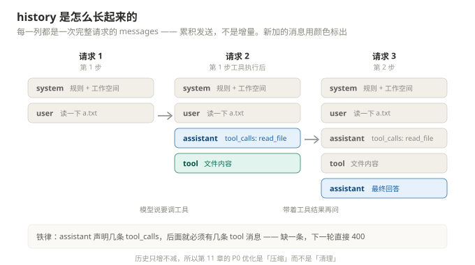

# 第 4 章 · 主循环 `run_turn`

**本章产出**：`agent/loop.py`，约 150 行。到本章结束，agent 真的会"自己干活"了 —— 它读完文件再回答，不需要你手动搬数据。

---

## 一、循环要解决的唯一问题

模型只会说"我想调 `read_file({"path": "README.md"})`"，**它不会执行，也不会再问第二遍**。所以需要代码做这件事：

```
用户提问
  ↓
① 发请求（带 tools）→ 模型返回 tool_calls
  ↓
② 执行工具，把结果作为 role=tool 消息追加进 history
  ↓
③ 再发请求（history 现在包含工具结果）→ 模型这次给出真实回答
  ↓
④ 没有 tool_calls 了 → 结束
```

就这四步循环。写出来 30 行，但**要写对**需要处理 5 个边界情况，这才是本章真正的分量。

---

## 二、先看消息数组是怎么长起来的



每次循环，`history` 增长一条 assistant + N 条 tool。注意两个细节：

- **assistant 消息的 `tool_calls` 必须保留**，不然模型不知道那些 `tool` 消息是回答谁的
- **`tool` 消息要靠顺序对上**，不是靠 id（Ollama 的 `/api/chat` 用位置配对，不像 OpenAI 需要 `tool_call_id`）

---

## 三、`agent/loop.py`

```python
"""Agent 主循环：消息历史、工具派发、多步执行。"""
from __future__ import annotations

import json
import time

from agent.client import OllamaClient
from agent.config import AgentConfig
from agent.registry import ToolContext, ToolResult

import tools


def strip_old_images(history: list) -> None:
    """图片只在当前回合保留；历史里的图片剥掉省 token。"""
    for msg in history:
        if msg.get("images"):
            msg.pop("images", None)
            msg["content"] += "\n[图片已从上下文剥离以节省 token]"


def pad_unanswered_tool_calls(history: list) -> int:
    """打断收尾：末条 assistant 声明了 tool_calls 但缺响应时，补齐占位消息。

    返回补了几条。缺响应的 tool_calls 会让下一轮请求被 Ollama 拒绝
    （assistant.tool_calls 必须跟对应的 tool 消息一一对应），所以必须补。
    """
    idx = len(history) - 1
    answered = 0
    while idx >= 0 and history[idx].get("role") == "tool":
        answered += 1
        idx -= 1
    if idx < 0 or history[idx].get("role") != "assistant":
        return 0
    calls = history[idx].get("tool_calls") or []
    missing = calls[answered:]
    for tc in missing:
        history.append({"role": "tool",
                        "content": "[已被用户打断，未执行]",
                        "tool_name": (tc.get("function") or {}).get("name", "?")})
    return len(missing)


def new_history(workspace: str | None = None) -> list:
    from agent.config import SYSTEM_PROMPT
    prompt = SYSTEM_PROMPT
    if workspace:
        prompt += f"\n当前工作空间目录: {workspace}"
    return [{"role": "system", "content": prompt}]


def run_turn(client: OllamaClient, cfg: AgentConfig, ctx: ToolContext,
             history: list, user_text: str, images: list[str] | None = None,
             cancel=None) -> str:
    """跑一个用户回合（含多轮工具调用），返回最终回答。"""
    strip_old_images(history)

    user_msg = {"role": "user", "content": user_text}
    if images:
        user_msg["images"] = images
    history.append(user_msg)

    tools_spec = None if cfg.no_tools else tools.all_specs()
    final_text = ""
    resp: dict = {}

    def _stopped() -> bool:
        return cancel is not None and cancel.is_set()

    try:
        for step in range(1, cfg.max_steps + 1):
            if _stopped():
                print("\n[⏹ 已打断本轮回答]", flush=True)
                break
            print(f"\n─── 第 {step} 步", flush=True)

            resp = client.chat(
                history,
                tools=tools_spec,
                on_text=lambda t: print(t, end="", flush=True),
                on_think=lambda t: print(f"\033[2m{t}\033[0m", end="", flush=True),
                cancel=cancel,
            )
            print(flush=True)

            content = resp["content"]
            tool_calls = resp["tool_calls"]

            # ---- 情况 A：生成中途被打断 ----
            if resp.get("cancelled"):
                history.append({
                    "role": "assistant",
                    "content": (content + "\n[已被用户打断]").strip()
                               if content else "[已被用户打断]",
                })
                print("[⏹ 已打断本轮回答]", flush=True)
                return content

            # ---- 情况 B：正常一步，先记 assistant 消息 ----
            assistant_msg: dict = {"role": "assistant", "content": content}
            if tool_calls:
                assistant_msg["tool_calls"] = [
                    {"function": {"name": tc["function"]["name"],
                                  "arguments": tc["function"]["arguments"]}}
                    for tc in tool_calls
                ]
            history.append(assistant_msg)

            # ---- 情况 C：没有工具调用 = 最终回答 ----
            if not tool_calls:
                return content

            # ---- 情况 D：逐个执行工具 ----
            for i, tc in enumerate(tool_calls):
                name = tc["function"]["name"]
                args = tc["function"].get("arguments") or {}
                if not isinstance(args, dict):
                    args = {}

                if _stopped():
                    for tc2 in tool_calls[i:]:
                        history.append({"role": "tool",
                                        "content": "[已被用户打断，未执行]",
                                        "tool_name": tc2["function"]["name"]})
                    print("[⏹ 已打断，跳过未执行的工具]", flush=True)
                    return content

                print(f"⚙ 工具调用: {name}({json.dumps(args, ensure_ascii=False)[:300]})",
                      flush=True)
                t0 = time.time()
                result: ToolResult = tools.dispatch(name, args, ctx)
                dt = time.time() - t0
                preview = result.text[:1500]
                print(f"  ↳ ({dt:.1f}s) {preview}", flush=True)

                tool_msg: dict = {"role": "tool", "content": result.text,
                                  "tool_name": name}
                if result.images:
                    tool_msg["images"] = result.images
                history.append(tool_msg)
        else:
            # for 正常跑完（没 break）→ 步数用尽
            final_text = "[已达到最大工具步数，强制结束]"
            print(final_text, flush=True)
    except KeyboardInterrupt:
        pad_unanswered_tool_calls(history)
        print("\n[⏹ 已打断本轮回答]", flush=True)
        return resp.get("content") or ""

    return final_text
```

### 逐块解释

**`strip_old_images` 放在最前面**

因为要把**上一轮**留下的图剥掉，本轮新加的图还没进来。顺序反了就会把本轮刚附的图也删掉。

**assistant 消息只留三个字段**

```python
{"role": "assistant", "content": content, "tool_calls": [...]}
```

不要把 Ollama 返回的整个对象塞进来（它可能带 `thinking`、`images` 等）。历史里的字段越少越安全，某些字段会导致下一轮 400。

**`arguments` 必须是 dict**

```python
args = tc["function"].get("arguments") or {}
if not isinstance(args, dict):
    args = {}
```

模型偶尔会返回字符串形式的 arguments。`dispatch` 里会 `**kwargs`，字符串直接崩。这里兜住。

**`for ... else` 的用法**

```python
for step in range(1, cfg.max_steps + 1):
    ...
    if not tool_calls:
        return content       # 正常结束用 return，不是 break
else:
    final_text = "[已达到最大工具步数，强制结束]"
```

`else` 挂在 `for` 上，只有**循环跑完没被 break** 才执行。这里所有正常出口都是 `return`，所以能走到 `else` 的唯一情况就是"12 步了还在调工具"。

**四个 `return` 点，每个都要保证历史自洽**

| 出口 | history 状态 | 是否合法 |
|---|---|---|
| 情况 C 无工具调用 | assistant 完整消息 | ✅ |
| 情况 A 被打断 | assistant 带部分文本，**没有 tool_calls** | ✅ |
| 情况 D 工具间被打断 | assistant 的 tool_calls 全部补了占位 tool 消息 | ✅ |
| `KeyboardInterrupt` | `pad_unanswered_tool_calls()` 补齐 | ✅ |

这就是"不变量 1"的落地方式：**每一个出口都要自己收拾干净**，没有统一兜底的地方。

---

## 四、完整的 `SYSTEM_PROMPT`

现在工具有了，把第 2 章那 4 条规则换成 9 条。**规则不是凑数的，每条都对应一个真实失败模式**：

```python
SYSTEM_PROMPT = (
    "你是一个运行在本地的文件/网络/命令行助手。规则：\n"
    "1. 需要读文件、写文件、删除文件、精确改文件、列目录、搜代码、跑命令、"
    "看图片、读网页、联网搜索时，必须调用工具，不要凭空猜测文件内容。\n"
    "2. 工具结果拿到后继续调用需要的工具，直到信息足够，再给出最终回答。"
    "改代码的闭环：grep_file/glob_file 定位 → read_file 读懂 → edit_file 修改 → run_command 跑测试验证。\n"
    "3. 工具返回[错误]或失败时，如实告知失败原因，绝对不要编造工具结果、网页内容或链接。\n"
    "4. 回答用简体中文，直接、紧凑，先结论后细节。\n"
    "5. 读写文件默认在工作空间内进行：用户说的相对路径都相对工作空间；"
    "只有用户明确给出绝对路径时才用绝对路径。写文件前确认路径合理；引用网页时给出链接。\n"
    "6. 删除文件不可恢复：只在用户明确要求删除时调用 delete_file，删前复述要删的路径；"
    "非空目录必须传 recursive=true。\n"
    "7. 改文件优先 edit_file（old_string 与原文完全一致且唯一），整文件重写才用 write_file。"
    "run_command 的破坏性命令（删数据、git push --force 等）只在用户明确要求时执行。\n"
    "8. 生成 Excel（write_file 的 .xlsx）时 content 用 JSON 二维数组："
    '[[\"列1\",\"列2\"],[\"值1\",\"值2\"]]，首行表头；'
    "每行列数必须与表头一致，缺值用空字符串占位，绝不为省事少写整列（否则整行错位）。\n"
    "9. load_image 只能加载图片（png/jpg/webp/gif/bmp）。用户说\"打开/看一下 Excel、Word、"
    "PPT、PDF、CSV\"时一律用 read_file 解析文字内容，绝不要用 load_image。\n"
)
```

第 5 条（工作空间语义）和第 3 条（不许编造）是**收益最高的两条**，值得单独抄出来。

---

## 五、更新 `main.py`

```python
"""临时入口（第 6 章会被 cli.py 取代）。"""
from __future__ import annotations

import argparse
from pathlib import Path

from agent.client import OllamaClient
from agent.config import AgentConfig
from agent.loop import new_history, run_turn
from agent.registry import ToolContext


def main() -> None:
    ap = argparse.ArgumentParser()
    ap.add_argument("prompt", nargs="*")
    ap.add_argument("-m", "--model")
    ap.add_argument("-w", "--workspace", default="")
    ap.add_argument("--max-steps", type=int, default=12)
    ap.add_argument("--think", default="off")
    ap.add_argument("--no-tools", action="store_true")
    args = ap.parse_args()

    cfg = AgentConfig(think=args.think, max_steps=args.max_steps,
                      no_tools=args.no_tools)
    if args.model:
        cfg.model = args.model

    workspace = Path(args.workspace).expanduser().resolve() if args.workspace \
        else Path.cwd()
    cfg.workspace = str(workspace)

    client = OllamaClient(cfg)
    ctx = ToolContext(workspace=workspace, confirm=False)
    history = new_history(str(workspace))

    def ask() -> str:
        try:
            return input("\n你> ").strip()
        except (EOFError, KeyboardInterrupt):
            raise SystemExit(0)

    if args.prompt:
        print(run_turn(client, cfg, ctx, history, " ".join(args.prompt)))
        return

    print(f"Ollama Agent | {cfg.model} | 工作空间 {workspace}")
    while True:
        text = ask()
        if not text:
            continue
        if text in ("/exit", "/quit"):
            break
        run_turn(client, cfg, ctx, history, text)
        print()


if __name__ == "__main__":
    main()
```

---

## 六、验证

### 1. 一次真正的多步任务

```bash
python main.py -w . "看一下当前目录有哪些文件，挑一个 py 文件读前 20 行，然后告诉我它是干什么的"
```

期望看到：

```
─── 第 1 步
⚙ 工具调用: list_dir({"path": "."})
  ↳ (0.0s) [目录] D:\...\agent-from-scratch

─── 第 2 步
⚙ 工具调用: read_file({"path": "main.py", "limit": 20})
  ↳ (0.0s) [文本] ... 共 58 行，显示 1-20 行

─── 第 3 步
这是一个命令行入口程序，它……
```

**第 1 步的 `content` 是空的** —— 模型只输出工具调用，不输出文字。这是正常的。

### 2. 错误恢复

```bash
python main.py "读一下 config.json"
```

（工作空间里没有这个文件）

期望：模型看到 `[错误] 文件不存在…` 之后，**自己改**去 `list_dir` 找，或者直接告诉你文件不存在。如果它连续三次重复同一个调用，说明你的错误信息不够可行动。

### 3. 步数上限

```bash
python main.py --max-steps 1 "把当前目录所有 py 文件都读一遍再总结"
```

期望：第 1 步调完工具就撞上限，输出 `[已达到最大工具步数，强制结束]`。

### 4. 关掉工具当普通聊天

```bash
python main.py --no-tools "你好"
```

期望：`tools_spec=None`，模型只能聊天。用来验证"工具是可选能力"，不是硬依赖。

---

## 七、踩过的坑

| 现象 | 原因 | 解决 |
|---|---|---|
| 第二轮请求 400，报 `tool_calls` 相关 | assistant 的 `tool_calls` 和 tool 消息数量不匹配 | 每个 `tool_call` 都要有一条 `tool` 消息，顺序一致 |
| 400 报 `invalid tool call` | `arguments` 是字符串不是对象 | 本章已兜 `isinstance(args, dict)` |
| 400 报 `unknown tool` | 模型编了个不存在的工具名 | `dispatch` 返回 `[错误] 未知工具: xxx`，模型会自己改 |
| 模型反复调同一个工具 12 次 | 工具每次返回同样内容 | 大概率是路径没解析对（`ctx.resolve` 用错），或工具静默失败返回了空串 |
| 回答里出现"根据工具结果…"但根本没调工具 | 模型幻觉 | prompt 第 3 条；也可以在 `stop` 里加"未调用工具时不许声称读过文件"，但**不要**这么做，会误伤正常回答 |
| Ctrl+C 之后下一轮就 400 | 历史里有孤立的 `tool_calls` | `pad_unanswered_tool_calls` 没接上，检查 `except KeyboardInterrupt` 分支 |
| 上下文越用越满 | 历史只增不减 | 真实仓库的 P0 优化项：自动摘要压缩（第 11 章） |
| `[图片已从上下文剥离]` 出现在奇怪的位置 | `strip_old_images` 改的是 `content` 字符串 | 只对含 `images` 的消息处理，已限定 |

---

## 八、过关自测

1. 为什么正常结束用 `return` 而不是 `break`？
2. 情况 A（生成中被打断）为什么**不**补 `tool` 消息？
3. 模型一次返回 3 个 `tool_calls`，执行到第 2 个时用户点了停止，历史应该长什么样？
4. 如果把 `history.append(assistant_msg)` 放在工具执行之后，会出什么问题？
5. `max_steps=12` 是"最多 12 次工具调用"还是"最多 12 次模型请求"？

<details>
<summary>答案要点</summary>

1. 因为 `for...else` 的 `else` 只在**没有 break** 时执行，而 `else` 分支是"步数用尽"的告警。用 `break` 会跳进 `else`，把正常回答覆盖成错误提示。
2. 因为 `client.chat` 在 `cancelled=True` 时已经把 `tool_calls` 清空了 —— assistant 消息里根本没有 `tool_calls`，自然不需要配对的 `tool` 消息。
3. assistant 带 3 个 tool_calls；`tool` 消息 1 条（第 1 个已执行）+ 2 条占位（`[已被用户打断，未执行]`）。对应代码里 `for tc2 in tool_calls[i:]` 那段。
4. 工具执行时如果抛异常/被打断，assistant 消息就丢了，但那 N 条 tool 消息已经进历史 —— 历史里出现"没有父亲的 tool 消息"，下一轮 400。
5. 模型请求次数。一次请求可能返回多个工具调用，一次工具调用不额外消耗 step。

</details>

---

下一章：把 `print` 从内核里赶出去 → [第 5 章](05-emitter.md)
