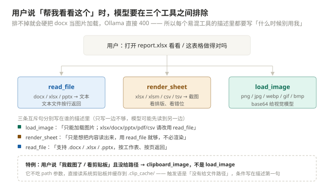

# 第 9 章 · 模型侧：描述和提示词怎么写才有用

**本章产出**：一套可操作的"写描述 / 写提示词"方法，全部用仓库里 15 个工具的真实 description 做正反例；外加一个不到 90 行的离线评测脚本，**实测出这套描述的工具命中率是 75%**，并逐条解释那 5 个 miss。

本章几乎不写产品代码 —— 改的全是字。但它决定了前 8 章写的能力**有几分被真正用上**。

---

## 一、先承认：这个项目的"提示词"比代码难改

代码写错了会报错、会测试失败、会崩。描述和提示词写错了**什么都不发生** —— 模型只是沉默地选错工具，然后你归因为"这个模型不行"。

模型手里只有三份材料，它们合起来就是它的全部世界观：

| 位置 | 回答的问题 | 何时读到 | 变更成本 |
|---|---|---|---|
| 系统提示词 `SYSTEM_PROMPT` | 全局：什么情况必须用工具、路径怎么理解、哪些操作要谨慎 | 每一轮 | 一处改动，影响全部 15 个工具 |
| 工具 `description` | 局部：这个工具解决什么问题、边界在哪、最容易和谁混 | 每一轮（在 tools 数组里） | 一个文件 |
| 工具返回的 `[错误]` 文案 | 事后：刚才错在哪、下一步该写成什么样 | 出错才读 | 一处，只影响该失败路径 |

前两个是**事前预防**，第三个是**事后纠正**。三者要一起设计 —— 只改描述不写错误文案，模型会在同一个坑里反复摔；只写错误文案不改描述，模型会稳定地先错一次。

---

## 二、先量一下预算（真实数字，可复现）

跑这段，你自己也能量：

```python
import json, sys
sys.path.insert(0, ".")
import tools                                  # 触发 15 个 @tool 注册
from agent.registry import all_specs
from agent.config import SYSTEM_PROMPT

specs = all_specs()
print("工具数:", len(specs))
print("tools JSON 字符:", len(json.dumps(specs, ensure_ascii=False)))
print("系统提示词字符:", len(SYSTEM_PROMPT))
for t in sorted(specs, key=lambda s: -len(s["function"]["description"])):
    f = t["function"]
    print(f'{f["name"]:<17}{len(f["description"]):>5}')
```

本仓库的实际输出（前 3 行，后面还有 15 个工具的 desc 长度）：

```text
工具数: 15
tools JSON 字符: 7734
系统提示词字符: 976
…
```

拆开看这 7734 字符的构成：


| 部分 | 字符 | 占比 | 谁写的 |
|---|---|---|---|
| 参数 JSON Schema | 3977 | 46% | 代码自动生成（每个属性 3 个键 + 类型） |
| 工具 description | 2358 | 27% | **人写的** |
| 工具名 + `type/function` 包装 | 1399 | 16% | 代码自动生成 |
| 系统提示词 | 976 | 11% | **人写的** |

**结论一：工具描述是系统提示词的 2.4 倍。** 所谓"写提示词"，主战场其实在 `tools` 数组里，不在那句 `system` 里。只精心打磨系统提示词、description 随手写两笔，是典型的用力用错地方。

**结论二：别忘了每轮都要重发。** 8700 字符常驻，在 32k 上下文里占掉约 18%（中文粗估 1.5 字/token ≈ 5.8k token）。这也解释了仓库里另外两个设计：技能只把 **名字 + 60 字符描述** 放进提示词（`skill_index` 里那句 `d[:60]`），正文等模型主动调；工具返回值统一用 `clip_text` 掐头去尾。

**结论三：15 个 desc 的平均长度 157 字符。** 分档看：

| 区间 | 工具 | 说明 |
|---|---|---|
| 300–360 | `write_file`(360) | 一个工具扛三种文件格式，长是必然的 |
| 200–300 | `run_command`(290) `grep_file`(241) `glob_file`(207) `edit_file`(202) | 有边界、易混、参数有语义 → 必须写 |
| 120–200 | `web_search` `load_image` `delete_file` `read_file` `render_sheet` | 常规长度 |
| <120 | `clipboard_image`(109) `web_chat`(105) `skill`(88) `list_dir`(57) `browse_url`(40) | 边界天然清楚，不需要解释 |

这条区间就是你们的**预算线**：短于 60 字符，大概率边界没说清；长于 400 字符，大概率是在描述里写文档。

---

## 三、六条写法规则（每条都用真实描述验证过）

### 规则 1：写"用户的措辞"，不写"工具的能力"

能力描述是给同行看文档用的，模型不需要。模型在选工具时匹配的是**用户原话里的词**。

看仓库里四个真实例子，注意引号里的都是用户口语：

```python
# clipboard_image
"用户说「看剪贴板」「我截图了」「看这张图」而没有给文件路径时调用它。"

# render_sheet
"用于回答「表格做得对不对 / 长什么样 / 截个屏看看 / 排版有没有错位」。"

# glob_file
"用于：'有哪些测试文件'、'src 下有哪些 ts'、找配置文件/入口文件。"

# grep_file
"用于定位：函数/类在哪定义、谁调用了它、哪些文件包含某配置项或字符串。"
```

反例推演：`write_file` 如果只写"写入文件"，用户说"**帮我做个表格**"时，模型根本连不上线 —— "表格"这个词不在描述里。真实描述里塞进了 `.xlsx`、`Excel 表格`、`JSON 二维数组`，模型才能在"做个表格"和 `write_file` 之间建立连接。

**操作建议**：写完一条描述，把你预期的 3–5 句用户原话念一遍，逐个在描述里找对应的词。找不到就补进去。

### 规则 2：易混工具必须写"什么时候别用我 + 去哪"

这是全章最重要的一条。三个"读东西"的工具是重灾区：



互斥句必须**两边都写**，不能只写一边 —— 模型读 tools 数组是平行扫的，可能先看到被推荐的那个，也可能先看到该排除的那个：

| 工具 | 描述里的排除句（原文） |
|---|---|
| `load_image` | "**只能加载图片**：xlsx/docx/pptx/pdf/csv 等文档不要用它，请改用 read_file 解析文本内容。" |
| `render_sheet` | "只是想把内容读出来用 read_file 就够，不必渲染。" |
| `read_file` | 正面写清支持 `.docx` / `.xlsx` / `.pptx`（按工作表、按页返回） |
| `glob_file` | "查文件内容用 grep_file。" |
| `grep_file` | "定位到文件后用 read_file 读上下文，用 edit_file 修改。" |
| `edit_file` | "适合改函数/配置/单行的小改动；整个文件重写或新建文件才用 write_file。" |

**判断标准很简单**：两个工具的参数有 50% 以上重叠（都要 `path`），就必须互相写一句"你别用我"。`read_file` / `render_sheet` / `load_image` / `clipboard_image` 四个都在抢同一个意图 —— "帮我看个东西" —— 所以四个都有互斥句。其中 `clipboard_image` 是靠**条件**把自己摘出来的："用户没给文件路径 + 刚从剪贴板"。

### 规则 3：参数说明写"默认值 + 范围 + 语义反例"

模型最容易错的不是"该不该调这个工具"，而是"参数填什么"。`required` 只约束"必须给"，不约束"给对"。

```python
# run_command 的 timeout —— 范围 + 默认值 + 后果
{"type": "number", "description": "超时秒数（1-600），默认 120。超时自动终止命令"}

# delete_file 的 recursive —— 什么条件必须传
{"type": "boolean", "description": "删除非空目录时必须传 true（连同目录下所有内容一起删），默认 false"}

# grep_file 的 glob —— 这不是类型说明，是语义说明
{"type": "string", "description": "只搜匹配的文件，如 `*.py`、`src/**/*.ts`。不传 = 全部文本文件"}

# write_file 的 content —— 直接给可复制片段，比描述格式更有效
{"type": "string",
 "description": "完整内容。.xlsx 推荐 JSON 二维数组 `[[\"列1\",\"列2\"],[\"值1\",\"值2\"]]`，首行表头……"}
```

注意 `grep_file.glob` 那句"**不传 = 全部文本文件**" —— 这是在解释**默认行为**，不是解释类型。同类还有主描述里那句"不含 `/` 的模式任意子目录都匹配"，它讲的是反直觉语义（命令行 grep 里 `*.py` 通常不递归，这个工具递归）。类型是 `string` 这件事模型一眼就知道，不用解释；**反直觉的语义必须解释**。

**另一个易踩点**：默认值一定要写在 description 里。模型不知道 Python 的默认参数，它只知道 description —— 没写默认值，它就会把每个参数都显式填一遍，填错的机会也跟着变大。

### 规则 4：描述里的数字从常量插值，绝不手写

`tools/render_sheet.py` 里这一行值得单独拎出来：

```python
MAX_ROWS = 200

# tools/render_sheet.py 里 max_rows 参数的定义
{"type": "integer",
 "description": f"最多渲染多少数据行，默认 40，上限 {MAX_ROWS}"},
```

为什么不是 `"上限 200"`？因为描述是模型判断"能不能一次看完"的依据。哪天 `MAX_ROWS` 改成 500 而描述忘了改，**不会报错** —— 模型会以为最多 200 行，于是把一个表分三次渲染，你只会觉得"今天模型有点笨"。

**这是全章最容易被忽略的一条：凡是能被代码算出来的事实，都不要在描述里硬编码。**

### 规则 5：把"下一步"写进描述，让工具长成流程

```python
# edit_file：改完该干什么
"改完建议 read_file 复核，代码改动用 run_command 跑测试验证。"

# grep_file：定位完该干什么
"结果过多会截断；定位到文件后用 read_file 读上下文，用 edit_file 修改。"

# web_search：够了就停（反向的下一步，更值钱）
"AI 聚合摘要……摘要足够可直接回答，无需逐条 browse_url。"
```

最后那句尤其关键。写清"**够用就停**"比写清"还能干什么"更能省 token —— 模型不知道何时收手的典型表现是：搜到答案了还要再 `browse_url` 两个链接，白烧 3000 token。

### 规则 6：高危工具的写法跟普通工具不一样

7 个 `confirm=True` 的工具，描述里都有"只在用户明确要求时"这类约束：

```python
# delete_file
"破坏性操作删错无法找回：只在用户明确要求删除时使用，删前先确认路径。"

# run_command
"破坏性命令（删数据、git push --force、覆盖发布等）只在用户明确要求时执行。"
```

为什么要写这句？因为确认闸的成本是**打断用户**。模型误触发一次确认，你就要放下手上的事看一眼弹窗 —— 一天十次足够让你关掉 `--confirm`，然后连真正的删除都不再确认。

**这条不是安全措施**（安全靠 `confirm` 闸和 `ctx.resolve` 的路径约束），它优化的是**打扰频率**。安全边界要写死，打扰频率要调优。

---

## 四、系统提示词：只写"跨工具"的规则

判断标准一句话：

> **规则涉及的工具 ≥ 2 个 → 进系统提示词；只涉及 1 个工具 → 进那个工具的 description。**

拿这个标准去审仓库的 9 条：

| 条 | 内容摘要 | 涉及工具 | 落点判定 |
|---|---|---|---|
| 1 | 读/写/删/改/列目录/搜代码/跑命令/看图/读网页/联网时必须用工具 | 全部 | prompt ✅ |
| 2 | 拿到结果继续调直到足够；改代码闭环 `grep → read → edit → run` | 4 个 | prompt ✅ 跨工具流程 |
| 3 | 失败如实告知，绝不编造结果 | 全部 | prompt ✅ |
| 4 | 中文、紧凑、先结论后细节 | 无（输出风格） | prompt ✅ |
| 5 | 相对路径锚定工作空间 | 全部文件类 | prompt ✅ |
| 6 | 删除不可恢复，非空目录要 `recursive=true` | `delete_file` | description 为主，prompt 里也写了一遍 |
| 7 | 改文件优先 `edit_file`；破坏性命令要谨慎 | 2 个 | prompt ✅ |
| 8 | xlsx 内容规约（列对齐、字段归列、不合并续行） | `write_file` | prompt（见下） |
| 9 | `load_image` / `read_file` / `render_sheet` 三者路由 | 3 个 | prompt ✅ 任何单条描述都装不下 |

### 为什么第 8 条在 prompt 里，而不是全塞进 `write_file`

它其实被拆成了两半，分得很清楚：

| 类型 | 内容 | 放哪 | 理由 |
|---|---|---|---|
| **格式契约** | content 传 JSON 二维数组、首行表头 | `write_file` 的 description | 只跟这个工具的入参有关，写一次够 |
| **内容判断力** | 邮箱进邮箱列、不按原文出现顺序硬搬、不把续行合并成一行、缺值用空串占位 | prompt 第 8 条 | 它约束的是"怎么组织内容"，跨多个具体场景，需要一种态度 |

反过来推：如果把第 8 条整段塞进 `write_file` 的 description，它会在"写普通 txt"时也被模型读一遍，稀释掉真正相关的部分 —— 而 `write_file` 本来就是全仓库最长的一条（360 字符）。

### 冗余是故意的，但只给"最贵的错误"冗余

路径规则、删除、`edit` vs `write` 这三类在 prompt 和 description 里各有一份。为什么不怕浪费？

因为这三类错误的代价是**用户数据**（写错目录、误删、整文件被覆盖），而重复的成本是几百字符。**给贵错误留双保险，给便宜错误只留一处。**

### 跨工具规则的写法：给一条决策链，不给形容词

第 9 条原文（节选）：

```
9. load_image 只能加载图片（png/jpg/webp/gif/bmp）。用户说"打开/看一下 Excel、Word、
   PPT、PDF、CSV"时一律用 read_file 解析文字内容，绝不要用 load_image ——
   文档不是图片，硬当图片加载会让模型直接报错。用户要「看表格长什么样/截个屏/
   检查排版对不对」时，用 render_sheet……
```

它做了四件事：**列举触发词**（打开/看一下 + 格式名）→ **给出动作**（一律用 read_file）→ **给禁令 + 解释**（绝不要用 load_image，因为会报错）→ **给第二分支**（要看排版就 render_sheet）。

对比一下常见的失败写法：`"注意区分文档和图片。"`（形容词，无动作）、`"不要用 load_image 读文档。"`（只有禁令，模型换错工具）。

---

## 五、九条提示词的写法特征（可直接照抄的模板）

把真实提示词拆开看，能抽出 5 个可复用特征：

**1. 编号 + 一条一主题，不用散文。** 9 条规则共 976 字符（含开篇一句定位），平均每条约 100 字符。散文式提示词（"你需要先判断用户意图，然后……"）在长上下文里会被稀释，编号列表不会。

**2. 绝对词 + 具体动作。** "必须调用工具"、"绝对不要编造工具结果"、"一律用 read_file"、"绝不为省事少写整列"。软词（"尽量"、"最好"、"建议"）在 8000 字符的上下文里约等于没说。

**3. 每条尽量带后果。** "否则整行错位"（第 8 条）、"硬当图片加载会让模型直接报错"（第 9 条）、"删错无法找回"（第 6 条）。给后果的规则不容易被忽略 —— 模型没被"禁止"，只是被提醒了代价。

**4. 给替代方案，不只给禁令。** "不要用 load_image → 改用 read_file / render_sheet"。只给禁令时，模型要么愣住（不调了），要么换一个同样错的工具。

**5. 不写寒暄、不写角色戏。** 真实提示词开篇只有一句定位 —— "你是一个运行在本地的文件/网络/命令行助手"，后面全是规则。角色设定（"你是一位经验丰富的资深工程师，你严谨细致……"）消耗 token 但不改变行为，反而挤占规则的位置。

照这个结构写的模板：

```text
你是<一句话定位>。规则：
1. <什么情况必须做什么>，<否则会怎样>。
2. <跨工具流程>：A → B → C → D。
3. 工具返回错误时<怎么处理>，绝不<什么>。
4. 输出风格：<语言 / 长度 / 结构>。
5. 路径约定：<相对路径怎么理解>。
6. <高危操作>：只在<条件>时执行，执行前<做什么>。
7. <易混工具>怎么选：<场景 A>用 X，<场景 B>用 Y。
8. <内容规约>：<正面示例>，<负面示例>，<后果>。
```

---

## 六、四个真实的坏描述（含仓库自己的一个瑕疵）

| 坏写法 | 症状 | 改法 |
|---|---|---|
| `"读取文件"` | 模型在 `.docx` 上也调它，拿到二进制乱码后开始编造"这个文档讲的是……" | 列出支持格式，并写清"看不懂就报错" |
| `"加载图片"` | 模型拿它读 PDF / xlsx，Ollama 直接 400（图片字段不合法） | 加"**只能加载图片**" + 指路 `read_file`，prompt 第 9 条再兜一次 |
| `"搜索文件"`（glob 与 grep 共用一句） | 想要内容却传了文件名模式，拿到空结果后改口说"没有这个文件" | 一个写"按**文件名/路径模式**"，一个写"在**文件内容**里搜正则"，并互相指路 |
| 同义枚举：`web_search.engine` 的 `["auto","both","baidu","bing"]`，描述却写 "auto/both(默认,双引擎全量)" | `auto` 和 `both` 语义相同 → 模型在两个值之间随机选，评测时表现为"参数抖动"，看起来像模型不稳定 | 删掉 `auto`，或给它真实语义（如"auto = 先 bing，结果差再补百度"） |

最后一条是仓库自己的瑕疵，特意留着当例子：**描述会腐化**。枚举值是代码，描述是文字，两边会漂移而没人报错。所以本章第八节要给一个能定期跑的评测。

---

## 七、错误文案是第二次 prompt

工具失败时，模型唯一能读到的就是那段 `[错误]` 文本。它要么变成修正的线索，要么变成一次无效重试。

好的错误文案写三件事：**哪儿错了（定位）→ 正确姿势是什么（祈使句）→ 一个能直接照抄的示例**。

`agent/docgen.py` 的 `_validate_rectangular` 是仓库里写得最好的一段：

```text
工作表「Sheet1」行列数不一致：首行 5 列，第 3 行 4 列、第 7 行 3 列 等共 2 行。
每行列数必须与首行相同，缺的列用空字符串占位（不要省掉整列，否则数据会错位）。
推荐 content 直接传 JSON 二维数组：[["列1","列2","列3"],["值1","","值3"]]
```

三件事齐了：定位到具体行、给出祈使句、给可复制示例。对比坏文案 `[错误] 写入失败` —— 模型只能原样重试，两三轮后道歉收场。

`write_file` 遇到旧格式也一样，不只说"不支持"，还给了替代方案：

```python
f"[错误] 旧版二进制格式 {suf} 不支持写入，会是伪文件。"
f"请改用 {'xlsx' if suf == '.xls' else 'docx' if suf == '.doc' else 'pptx'} 扩展名"
```

**规则：写工具时，把错误信息当"返回给模型的核心产出"来设计，而不是当日志。** 日志是给人看的，错误文案是给模型看的 —— 两者的读者不同，写法就该不同。

---

## 八、怎么知道改好了：离线命中率评测

前面全是方法，这一节给数字。

思路：**只问模型"这种情况下你会调哪个工具"，不执行工具。** 一条用例一次请求，20 条用例 20 次请求，不写盘、不联网、不动历史。

新建 `evals/tool_hit.py`：

```python
"""evals/tool_hit.py —— 工具命中率评测。

只问模型"这种情况你会调哪个工具"，不执行工具、不改任何文件。
用法（在仓库根目录跑）：python evals/tool_hit.py [模型名]
"""
from __future__ import annotations

import json
import sys
import urllib.request
from collections import Counter

sys.path.insert(0, ".")          # 让脚本能 import 项目内的 agent / tools

import tools                     # noqa: F401  触发 15 个 @tool 注册，删了就是 0 个工具
from agent.config import DEFAULT_HOST, DEFAULT_MODEL, SYSTEM_PROMPT
from agent.registry import all_specs

# ---- 评测集：真实用户话术 → 期望工具 --------------------------------
CASES: list[tuple[str, str]] = [
    ("report.xlsx 里第三行写了什么", "read_file"),
    ("这表格做得对不对，帮我看看排版有没有错位", "render_sheet"),
    ("我刚截图了，你看一下", "clipboard_image"),
    ("assets/logo.png 这张图里是什么", "load_image"),
    ("项目里有哪些测试文件", "glob_file"),
    ("谁调用了 run_turn 这个函数", "grep_file"),
    ("src 这个目录下面有什么", "list_dir"),
    ("把 logs 目录整个删掉", "delete_file"),
    ("跑一下 tests 里那个测试", "run_command"),
    ("把 config.py 里的 8888 改成 9000", "edit_file"),
    ("新建 notes.md，写三行使用说明", "write_file"),
    ("查一下 Ollama 现在最新版本是多少", "web_search"),
    ("https://example.com/a 这篇讲什么", "browse_url"),
    ("a.docx 的正文读出来", "read_file"),
    ("把 data.csv 转成 Excel", "write_file"),
    ("现在有哪些技能可用", "skill"),
    ("这个结论我不确定，找个更强的模型复核", "web_chat"),
    ("a.pptx 第 3 页写了什么", "read_file"),
    ("看看 models 文件夹下面有哪些文件", "list_dir"),
    ("把 data 目录下所有 json 里含 timeout 的找出来", "grep_file"),
]


def first_tool(model: str, text: str) -> str:
    """返回模型第一个工具调用的名字；没调工具返回 "(未调用)"。"""
    payload = {
        "model": model,
        "stream": False,                       # 评测不需要流式，省一半代码
        "options": {"temperature": 0},         # 必须 0，否则同一条用例结果会飘
        "messages": [
            {"role": "system", "content": SYSTEM_PROMPT},
            {"role": "user", "content": text},
        ],
        "tools": all_specs(),                  # 跟真实回合发的是同一份
    }
    req = urllib.request.Request(
        f"{DEFAULT_HOST}/api/chat",
        data=json.dumps(payload).encode(),
        headers={"Content-Type": "application/json"},
    )
    with urllib.request.urlopen(req, timeout=180) as resp:
        data = json.loads(resp.read())
    calls = (data.get("message") or {}).get("tool_calls") or []
    return calls[0]["function"]["name"] if calls else "(未调用)"


def main() -> None:
    model = sys.argv[1] if len(sys.argv) > 1 else DEFAULT_MODEL
    hit = 0
    confusion: Counter[str] = Counter()

    for text, expect in CASES:
        got = first_tool(model, text)
        ok = got == expect
        hit += ok
        if not ok:
            confusion[f"{got} → 应为 {expect}"] += 1
        print(f"{'PASS' if ok else 'FAIL'}  {got:<16} {text}", flush=True)

    total = len(CASES)
    print(f"\n命中率 {hit}/{total} = {hit / total:.0%}   模型 {model}")
    if confusion:
        print("混淆对（按出现次数排序）：")
        for pair, n in confusion.most_common():
            print(f"  {n}×  {pair}")


if __name__ == "__main__":
    main()
```

跑：

```bash
python evals/tool_hit.py
```

输出（下面这份是**实测**：`qwen3.5:9b` Q4_K_M、temperature 0、20 条一次跑完约 14 分钟）：

```text
PASS  read_file        report.xlsx 里第三行写了什么
FAIL  list_dir         这表格做得对不对，帮我看看排版有没有错位
PASS  clipboard_image  我刚截图了，你看一下
PASS  load_image       assets/logo.png 这张图里是什么
PASS  glob_file        项目里有哪些测试文件
PASS  grep_file        谁调用了 run_turn 这个函数
PASS  list_dir         src 这个目录下面有什么
PASS  delete_file      把 logs 目录整个删掉
FAIL  glob_file        跑一下 tests 里那个测试
FAIL  glob_file        把 config.py 里的 8888 改成 9000
PASS  write_file       新建 notes.md，写三行使用说明
PASS  web_search       查一下 Ollama 现在最新版本是多少
PASS  browse_url       https://example.com/a 这篇讲什么
PASS  read_file        a.docx 的正文读出来
FAIL  read_file        把 data.csv 转成 Excel
PASS  skill            现在有哪些技能可用
FAIL  (未调用)          这个结论我不确定，找个更强的模型复核
PASS  read_file        a.pptx 第 3 页写了什么
PASS  list_dir         看看 models 文件夹下面有哪些文件
PASS  grep_file        把 data 目录下所有 json 里含 timeout 的找出来

命中率 15/20 = 75%   模型 qwen3.5:9b
混淆对（按出现次数排序）：
  1×  list_dir → 应为 render_sheet
  1×  glob_file → 应为 run_command
  1×  glob_file → 应为 edit_file
  1×  read_file → 应为 write_file
  1×  (未调用) → 应为 web_chat
```

### 这 5 个 miss 里，只有 2 个是真错

75% 看起来像"描述写得一般"，但逐条看下去结论完全不同：

| 用例 | 模型选了 | 判断 |
|---|---|---|
| 这表格做得对不对，帮我看看排版有没有错位 | `list_dir` | **真错**。触发语料完全命中（render_sheet 描述里就有"排版有没有错位"原句），但用户没给文件名，描述里又没写"文件没指定时怎么办"，模型就先跑去列目录了 |
| 跑一下 tests 里那个测试 | `glob_file` | **指标误判**。先 glob 找测试文件、再 `run_command` 跑 —— 这是合理策略，单步指标把多步的第一步算成了错 |
| 把 config.py 里的 8888 改成 9000 | `glob_file` | **指标误判**。同理，先定位文件再 `edit_file` |
| 把 data.csv 转成 Excel | `read_file` | **指标误判**，而且是**对的**：`write_file` 需要 content，必须先 `read_file` 把 csv 读出来。这一步不能省 |
| 这个结论我不确定，找个更强的模型复核 | *(未调用)* | **真错**。`web_chat` 描述里写了"需要更强模型二次判断"，但缺"复核 / 我不确定"这类用户措辞，模型选择直接回答 |

两条结论比 75% 这个数字重要得多：

1. **单步命中率是粗指标。** 它测"第一个动作对不对"，不测"整条路径对不对"。要测后者得跑完整回合、断言最终产物（第 10 章的做法）。
2. **真错的只有 2 条，都是描述问题，而且改法很具体**：
   - `render_sheet` 缺一句"用户没给文件名时，先 glob_file 找 `*.xlsx` 再渲染"；
   - `web_chat` 缺"我不确定 / 复核 / 二次确认"这类措辞。

这就是改进循环：**跑 → 挑出真错 → 一次改一处 → 再跑**。剩下 3 条"探路型"不要动 —— 改了很可能把本来正确的行为改坏（比如逼模型跳过读文件直接写 content，那才是真灾难）。

留个练习：按上面两条改描述，重跑看是 17/20、16/20，还是把别的用例改坏了。

### 怎么读这个结果

| 现象 | 说明 | 改哪里 |
|---|---|---|
| 先跑一次，把这个数当基线 | 本仓库实测 75%，换模型会变（别跟别人的数字比） | 不急着改 |
| 命中率整体偏低（< 60%） | 描述里缺触发语料 | 补用户原话（规则 1） |
| 某一对工具反复互换（≥ 3 次） | 两边都没写互斥句 | 两边都补排除句（规则 2） |
| `glob_file` / `list_dir` 顶替执行型工具 | "探路型"误判：先找文件再动手，策略没错 | **别改**，除非它找完就不动了 |
| 该调的没调（`(未调用)`） | 触发语料缺那个词 | 把用户原话补进描述（规则 1） |
| 工具选对了，参数不对 | 参数说明不够 | 改该参数的 description（规则 3） |
| 该调工具却回了一段话 | 提示词第 1 条没覆盖这个场景 | 补 prompt 或补描述里的触发词 |
| 全部命中但实际用起来还是笨 | 说明问题在"多步规划"不在"单步选择" | 这不在本章范围，去看第 4 章的主循环与 steps 上限 |

### 三条使用纪律

1. **一次只改一处，改完重跑。** 同时改三条描述，命中率涨了也不知道是哪条起的作用。
2. **20 条只够发现大问题。** 差 1 条（5%）不要当结论，噪声就有这么大。
3. **think 开/关各跑一遍。** 想测开了思考的效果，往 `payload` 里加 `"think": True` 再跑 —— 用数据决定默认值，别凭感觉设 `cfg.think`。

---

## 九、踩过的坑

| 坑 | 表现 | 正解 |
|---|---|---|
| 描述写得越长越"详细" | 命中率反而降，关键句被稀释 | 关键约束放**第一句**，细节往后排；超过 400 字符就考虑拆工具 |
| 只写"必须"不写条件 | 模型过度调用：什么都先 `grep` 一遍 | 写"**当用户问……时**必须"，给触发条件 |
| 用输入/输出格式写示例 | "示例：输入 xxx，输出 xxx" 模型会照抄格式 | 给可直接复制的片段（`[["列1","列2"]]` 比"二维数组，第一行是表头"有效） |
| 改了描述不跑评测 | 以为"更详细 = 更好"，其实常常相反 | 一次一处 + 重跑（第八节） |
| 描述全中文，抹掉英文关键词 | 用户说 "Excel"、"pdf" 时匹配不上 | 中英混排："生成真正的 Excel 表格（.xlsx）"，"表格"和 "Excel" 两个词都要在 |
| 在 prompt 里介绍工具能力 | "你可以读写文件、联网搜索" —— 纯浪费 | tools 数组已经说了。prompt 只写"**何时**用、**怎么选**" |
| 拿 `**加粗**` 当强调手段 | 模型看到的是星号，不是粗体 | 加粗有没有用无法单独验证；**独立成句**是确定有效的，两个都做 |
| 工具越加越多 | 15 个之后选择面变大，平均命中率往下掉 | 能用参数表达的别开新工具：`web_search` 的 `engine`、`web_chat` 的 `site` 都是这么做的 |

最后一条值得展开：`web_search` 支持 Bing 和百度两条通道，但只有**一个工具**，通道是 `engine` 枚举参数。如果拆成 `web_search_bing` / `web_search_baidu` 两个工具，模型每次搜索都要多纠结一次，而收益为零。

---

## 十、过关自测

1. 为什么说"写提示词的主战场在 tools 数组"？给出本仓库的两个数字。
2. `read_file` 和 `render_sheet` 的互斥句，为什么必须**两边都写**？只写一边会怎样？
3. `render_sheet` 里 `上限 {MAX_ROWS}` 为什么不用 `上限 200`？这个错误会造成什么后果？
4. 系统提示词第 8 条（xlsx 内容规约）为什么不能整段挪进 `write_file` 的 description？
5. 一个错误文案要包含哪三件事？拿 `[错误] 写入失败` 说明缺了哪两件。
6. 评测结果里出现"`load_image` 与 `clipboard_image` 互换 4 次"，你第一步改哪里？

<details>
<summary>答案要点</summary>

1. 实测：tools 数组 7734 字符，系统提示词 976 字符 —— 前者是后者的 2.4 倍，而且工具描述是人手写的部分（2358 字符），系统提示词只有 976。
2. 因为模型是平行扫 tools 数组的，可能先读到被推荐的一方，也可能先读到该排除的一方。只在一方写，等价于赌模型先看到哪条；两边都写才能保证无论顺序如何，都能读到"该换谁"。
3. 因为 `MAX_ROWS` 是代码里的常量，会和描述漂移。描述写错不会报错，模型会按错误的"上限"规划，把一个表拆成多次渲染 —— 表现为"模型变笨了"，实际是文档在说谎。
4. 因为那段里有一半是**判断力**（字段按语义归列、续行不合并、不按原文顺序硬搬），不是格式契约。塞进 `write_file` 会让它在写普通 txt 时也被读一遍，稀释相关部分；而 `write_file` 已经是全仓库最长的描述（360 字符），再长会降准确率。
5. 定位（哪儿错了）+ 祈使句（正确姿势）+ 可复制示例。`[错误] 写入失败` 只有"失败了"三个字，缺定位，缺正解，模型只能原样重试。
6. 改这两个工具的**描述**，各补一句互斥说明：它们都不需要文件路径、都吃图片，唯一区别是"图片在磁盘上"还是"刚从剪贴板来"。给 `clipboard_image` 的触发条件写死"用户没给路径且刚截图"，给 `load_image` 写"用户给了文件路径时不必读剪贴板"。

</details>

---

下一章：不含模型也能测 agent → [第 10 章](10-testing.md)
