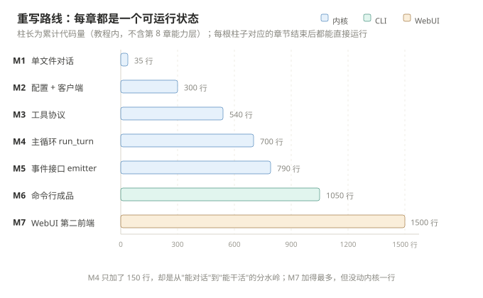

# 从零重写 ollama-agent：分步教程

> 这不是"源码导读"，是**施工手册**。每一章你都亲手加一层，每章结束都有一段能跑起来的代码。
> 全部敲完约 1500 行，得到的东西跟仓库里的 `agent/` + `tools/` 结构一致 —— 最后一步是把自己的代码和真实仓库对 diff。

- 想先看架构怎么想的 → [第 0 章](00-architecture.md)
- 想先看整个仓库长什么样 → [../CODE_READING.md](../CODE_READING.md)
- 想直接动手 → [第 1 章](01-hello-ollama.md)

---

## 一、为什么按这个顺序建

大多数 agent 教程的顺序是「先搭 Web 界面 → 再写 prompt → 最后接工具」，结果写到一半发现循环不会打断、工具调不通、历史不合法，只能推倒重来。

本教程的顺序由**依赖方向**决定，跟 `docs/diagrams/02-architecture.svg` 那张分层图完全一致：底下不稳不往上盖。



| 里程碑 | 章 | 你加什么 | 累计代码 | 跑起来看到什么 |
|---|---|---|---|---|
| M0 | 00 | 只做决策，不写代码 | 0 | 一张自己的架构草图 |
| M1 | 01 | 35 行单文件 | 35 | 终端里模型回你一句话 |
| M2 | 02 | `config.py` + `client.py` | ~300 | 回答**逐字吐出来**，能开关思考 |
| M3 | 03 | `registry.py` + 2 个工具 | ~540 | 模型主动要求读你的文件 |
| M4 | 04 | `loop.py` | ~700 | 模型自己读文件、再总结，全自动 |
| M5 | 05 | `events.py` + `console.py` | ~790 | 同一个内核，输出可以换成任意形式 |
| M6 | 06 | `cli.py` | ~1050 | 真正的命令行程序：REPL、`/命令`、`@文件`、确认闸 |
| M7 | 07 | `webui/` | ~1500 | 浏览器里对话，工具卡片逐个弹出 |
| M8 | 08 | 能力层（Office / 图片 / 技能） | 按需 | 让它写 xlsx、看截图、加载技能 |
| M9 | 09 | 模型侧：描述与提示词 | 0（改的是字） | 模型开始**选对**工具，而不是碰运气 |
| M10 | 10-11 | 测试 + 对照 | — | 你敢改它了 |

---

## 二、三条跑道（按你的目的选，不必全走）

| 跑道 | 走到哪 | 花多久 | 适合 |
|---|---|---|---|
| **A. 只想用起来** | 01 → 04 + 09 | 3–4 小时 | 想有个自己的本地 agent，不关心 WebUI（09 只读不敲代码，但决定它好不好用） |
| **B. 想读懂并改造**（推荐） | 00 → 11 | 9–11 小时，分 3–4 天 | 要在这套代码上做二次开发 |
| **C. 想抄架构做别的** | 00 → 05 + 08 + 09 | 5 小时 | 不写 agent，只要"工具循环 + 前端解耦 + 提示词分工"这套骨架 |

每章开头有 `本章产出`，结尾有 `过关自测`。**自测答不出来就别往下走** —— 后面的章节全都建立在前面的约定上。

---

## 三、前置环境

```bash
# 1. Ollama 服务（Windows 装完默认开机自启）
ollama serve
ollama pull qwen3.5:9b        # 或任意你显存扛得住的模型
ollama list                   # 记下准确名字，第 1 章要用

# 2. Python 3.10+（本项目用了 `X | None` 语法）
python --version

# 3. 建一个空目录开始施工（别在仓库里改，最后要对照）
mkdir D:/projectspace/agent-from-scratch
cd D:/projectspace/agent-from-scratch
```

**零第三方依赖**。第 2 章之前一行 `pip install` 都不需要 —— 这也是刻意的：`urllib` 够用，少一层依赖就少一层黑箱。到第 8 章写 Office 文件时才需要 `openpyxl` / `python-docx`，第 7 章之前完全不用。

---

## 四、最终目录形态

教程结束时你会有这些文件，跟仓库同名同层级，方便对照：

```
agent-from-scratch/
├── main.py                 # 第 2 章的临时入口，第 6 章换成 cli.py
├── agent/
│   ├── __init__.py
│   ├── config.py           # 第 2 章：默认值 + 系统提示词 + AgentConfig
│   ├── client.py           # 第 2 章：/api/chat 流式客户端
│   ├── registry.py         # 第 3 章：工具契约 + 注册表
│   ├── loop.py             # 第 4 章：run_turn 主循环
│   ├── console.py          # 第 5 章：着色 + UTF-8 输出
│   ├── events.py           # 第 5 章：ConsoleEmitter
│   └── cli.py              # 第 6 章：参数 + REPL
├── evals/
│   └── tool_hit.py         # 第 9 章：工具命中率评测（要连 Ollama）
└── tools/
    ├── __init__.py         # 第 3 章：自动发现
    ├── read_file.py        # 第 3 章
    └── list_dir.py         # 第 3 章
```

第 7 章的 `webui/`、第 8 章的能力层按需加，章节里给了完整骨架；第 9 章的 `evals/` 是唯一需要联网到 Ollama 才能跑的目录（和 `tests/` 的离线回归分工不同）。

---

## 五、每章的固定结构

| 小节 | 作用 |
|---|---|
| **本章产出** | 一句话说清完成后有什么 |
| **为什么这么做** | 这一层存在的理由、以及被否决的替代方案 |
| **动手** | 完整文件代码（不是片段），照抄可跑 |
| **验证** | 具体命令 + 期望输出，跑不通就是没懂 |
| **踩过的坑** | 真实会遇到的问题，提前避开 |
| **过关自测** | 3–5 个问题，答不出别往下 |

代码全部带注释，注释解释的是**为什么**，不是语法。

---

## 六、章节

| 章 | 标题 | 一句话 |
|---|---|---|
| [00](00-architecture.md) | 先想清楚，再写第一行 | 四个决策定终生：循环、工具、状态、输出 |
| [01](01-hello-ollama.md) | 35 行接通 Ollama | 把 `/api/chat` 当成一个普通 HTTP 接口 |
| [02](02-streaming-and-think.md) | 让文字流出来 | NDJSON 逐行解析、think 三态、错误重试 |
| [03](03-tool-protocol.md) | 工具是给模型看的 API | JSON Schema + 注册表 + 自动发现 |
| [04](04-agent-loop.md) | 主循环：`run_turn` | 消息配对、多步执行、三种打断 |
| [05](05-emitter.md) | 把输出抽象掉 | 8 个方法，换来两个前端 |
| [06](06-cli.md) | 命令行成品 | REPL、斜杠命令、`@` 引用、确认闸 |
| [07](07-webui.md) | 浏览器第二前端 | 手写 HTTP + NDJSON + 确认反向链路 |
| [08](08-capabilities.md) | 能力层 | Office 读写、图片、技能、加工具的套路 |
| [09](09-model-side.md) | 模型侧：描述与提示词 | 零行代码，决定前面 8 章的能力用上几成 |
| [10](10-testing.md) | 不含模型跑 agent | 五种造场景手段 + 六个真实测试 |
| [11](11-diff-to-repo.md) | 和真实仓库对账 | 差在哪、下一步优化什么 |

---

## 七、一句话忠告

写这套东西最容易犯的错，是**先想"功能"再想"结构"**。功能可以后加，结构错了每次加功能都要改三处。

判断标准很简单：**加一个新工具，要改几个文件？** 本项目的答案是 **1 个**（新建 `tools/xxx.py`）。如果你的实现要改注册表、改 prompt、改前端选项，说明结构没长对。
